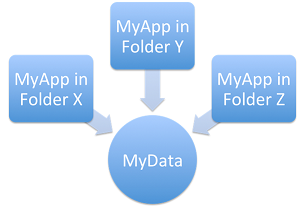
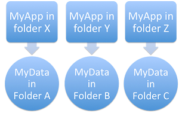
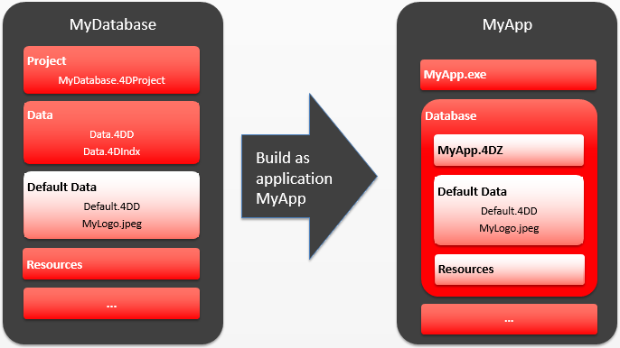

## Opening the data file  

When a user launches a merged application or an update (single-user or client/server applications), 4D tries to select a valid data file. Several locations are examined by the application successively.

The opening sequence for launching a merged application is:

1. 4D tries to open the last data file opened, [as described below](#last-data-file-opened) (not applicable during initial launch).
2. If not found, 4D tries to open the data file in a default data folder next to the .4DZ file in read-only mode.
3. If not found, 4D tries to open the standard default data file (same name and same location as the .4DZ file).
4. If not found, 4D displays a standard "Open data file" dialog box.

## Last data file opened

### Path of last data file  

Any standalone or server applications built with 4D stores the path of the last data file opened in the application's user preferences folder.

The location of the application's user preferences folder corresponds to the path returned by the following statement:

```4d
userPrefs:=Get 4D folder(Active 4D Folder)
```

The data file path is stored in a dedicated file, named *lastDataPath.xml*.

Thanks to this architecture, when you provide an update of your application, the local user data file (last data file used) is opened automatically at first launch.

This mechanism is usually suitable for standard deployments. However, for specific needs, for example if you duplicate your merged applications, you might want to change the way that the data file is linked to the application (described below).

### Configuring the data linking mode
  
With your compiled applications, 4D automatically uses the last data file opened. By default, the path of the data file is stored in the application's user preferences folder and is linked to the **application name**.

This may be unsuitable if you want to duplicate a merged application intended to use different data files. Duplicated applications actually share the application's user preferences folder and thus, always use the same data file -- even if the data file is renamed, because the last file used for the application is opened.

4D therefore lets you link the data file path to the application path. In this case, the data file will be linked using a specific path and will not just be the last file opened. You therefore link your data **by application path**.

This mode allows you to duplicate your merged applications without breaking the link to the data file. However, with this option, if the application package is moved on the disk, the user will be prompted for a data file, since the application path will no longer match the "executablePath" attribute (after a user has selected a data file, the *lastDataPath.xml* file is updated accordingly).

*Duplication when data linked by application name:*


*Duplication when data linked by application path:*


You can select the data linking mode during the build application process. You can either:

* Use the [Application page](building.md#application-page) or [Client/Server page](building.md#clientserver-page) of the Build Application dialog box.
* Use the **LastDataPathLookup** XML key ([single-user application](../BuildApplication/runtime-vl.md#lastdatapathlookup) or [server application](../BuildApplication/client-server.md#lastdatapathlookup)).

## Defining a default data folder

4D allows you to define a default data file at the application building stage. When the application is launched for the first time, if no local data file is found (see [opening sequence described above](#opening-the-data-file)), the default data file is automatically opened silently in read-only mode by 4D. This gives you better control over data file creation and/or opening when launching a merged application for the first time.

More specifically, the following cases are covered:

* Avoiding the display of the 4D "Open Data File" dialog box when launching a new or updated merged application. You can detect, for example at startup, that the default data file has been opened and thus execute your own code and/or dialogs to create or select a local data file.
* Allowing the distribution of merged applications with read-only data (for demo applications, for instance).

To define and use a default data file:

* You provide a default data file (named "Default.4DD") and store it in a default folder (named "Default Data") inside the application project folder. This file must be provided along with all other necessary files, depending on the project configuration: index (.4DIndx), external Blobs, journal, etc. It is your responsibility to provide a valid default data file. Note however that since a default data file is opened in read-only mode, it is recommended to uncheck the "Use Log File" option in the original structure file before creating the data file.
* When the application is built, the default data folder is integrated into the merged application. All files within this default data folder are also embedded.

The following graphic illustrates this feature:



When the default data file is detected at first launch, it is silently opened in read-only mode, thus allowing you to execute any custom operations that do not modify the data file itself.
