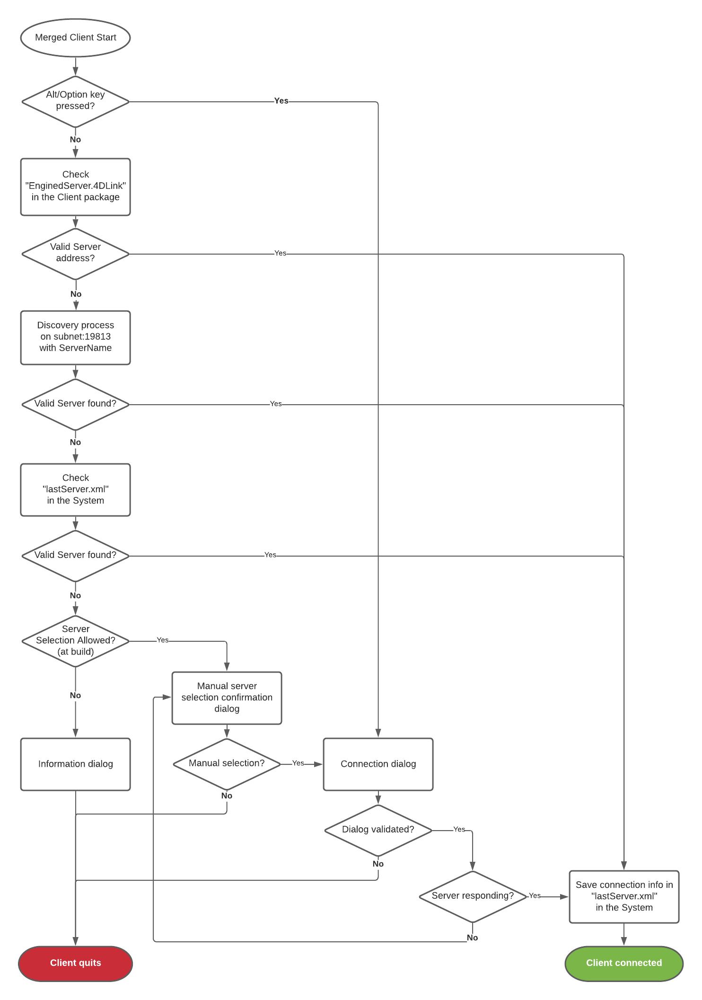
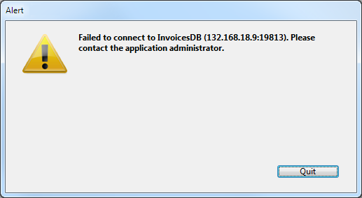
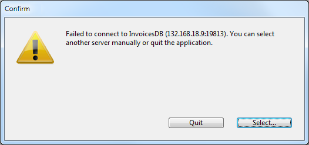
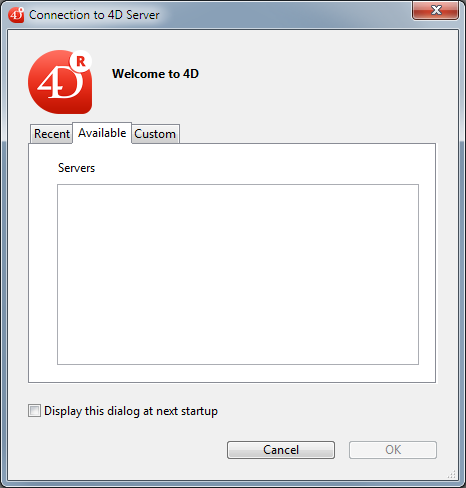

The management of connections by client applications covers the mechanisms by which a merged client application connects to the target server, once it is in its production environment.

## Connection scenario  

The connection procedure for merged client applications supports cases where the dedicated server is not available. The startup scenario for a 4D client application is the following:

1. If valid connection information is stored in the "EnginedServer.4DLink" file within the client application, the client application connects to the specified server address.  
 OR  
 The client application tries to connect to the server using the discovery service (based upon the server name, broadcasted on the same subnet).

2. If this fails, the client application tries to connect to the server using information stored in the application's user preferences folder ("lastServer.xml" file, see last step).
3. If this fails, the client application displays a connection error dialog box.

* If the user clicks on the **Select...** button (when allowed by the 4D developer at the build step, see below), the standard "Server connection" dialog box is displayed.
* If the user clicks on the **Quit** button, the client application quits.

4. If the connection is successful, the client application saves this connection information in the application's user preferences folder for future use.

The whole procedure is described in the following diagram:



## Storing the last server path  

The last used and validated server path is automatically saved in a file named "lastServer.xml" in the application's user preferences folder. This folder is stored at the following location:

```4d
userPrefs:=Get 4D folder(Active 4D Folder)
```

This mechanism addresses the case where the primary targeted server is temporary unavailable for some reason (maintenance mode for example). When this case occurs for the first time, the server selection dialog box is displayed (if allowed, see below) and the user can manually select an alternate server, whose path is then saved if the connection is successful. Any subsequent unavailability would be handled automatically through the "lastServer.xml" path information.

> * When client applications cannot permanently benefit from the discovery service, for example because of the network configuration, it is recommended that the developer provide a host name at build time using the [IPAddress](../BuildApplication/client-server.md#ipaddress) key in the "BuildApp.4DSettings" file. The mechanism addresses cases of temporary unavailability.  
> * Pressing the **Alt/Option** key at startup to display the server selection dialog box is still supported in all cases.

## Availability of the server selection dialog box in case of error

You can choose whether or not to display the standard server selection dialog box on merged client applications when the server cannot be reached. The configuration depends on the value of the [ServerSelectionAllowed](../BuildApplication/client-server.md#serverselectionallowed) XML key on the machine where the application was built:

* **Display of an error message with no access possible to the server selection dialog box**.  
Default operation. The application can only quit.  
`ServerSelectionAllowed`: **False** or key omitted  

    

* **Display of an error message with access to the server selection dialog box possible**.  
The user can access the server selection window by clicking on the **Select...** button.   
`ServerSelectionAllowed`: **True**  

     
     
