The Explorer is a window in the Design environment that gives you convenient access to tables, forms, methods, built-in 4D commands, constants and plug-ins. It also provides information about these items. You can display the Explorer at any time by choosing one of the pages in the **Design > Explorer** sub-menu or by clicking on the **Explorer** button in the toolbar.

:::note

For a comprehensive description of the Explorer, please refer to the [Explorer chapter on doc.4d.com](https://doc.4d.com/4Dv21/4D/21/Explorer.200-7676561.en.html).

:::


## Home page

The Home page shows the folders you create to organize the elements of your project (methods, classes, forms, tables...).

### Disk folders

In a [disk-folder project](../Project/architecture.md#disk-folder-projects), the folders of the Home page are the real folders found on disk under `Project/Sources`, and each method, class, project form, or Qodly page is shown in the folder where its file is stored. New projects are disk-folder projects. Other projects use virtual folders, stored in the `folders.json` file, until you [convert them](#converting-a-project).

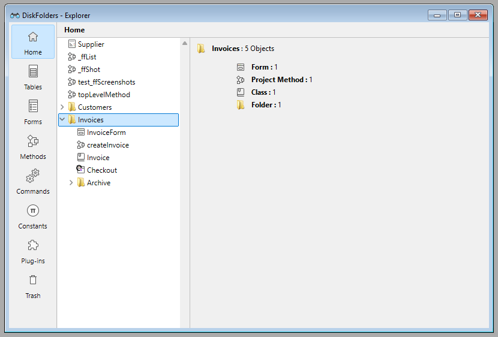

In a disk-folder project, every change made on the Home page is made on disk:

- Creating, renaming, or moving a folder creates, renames, or moves the folder under `Sources`, with all its content, and its mirror folder under `Documentation` when it exists.
- Moving a method, a class, a project form, or a Qodly page to a folder moves its file to the matching type folder of that folder (for example, `Sources/Invoices/Methods`). A project form moves with its method, its `Images` and its `ObjectMethods`. The element's documentation file moves with it.
- **Move To > Top Level** moves the file back to the type folder at the root of `Sources` (for example, `Sources/Methods`).
- Deleting an element of a folder moves its file to the Trash, in `Trash/<folder path>/<type folder>`.
- Deleting a folder moves its methods, classes, and project forms to the Trash with their folder path, moves its tables, table forms, and Qodly pages to Top Level, and removes the folder from `Sources`.
- Moving a table or a table form to a folder updates the `Sources/tableFolders.json` file.

If a file or folder cannot be moved (for example, a read-only file), 4D undoes the changes already made on disk and displays an alert with the path at fault: the folders and elements of the Home page stay unchanged.

:::note

When the project is opened by a remote 4D or is read-only, Home page changes are not saved on disk.

:::

#### Folder names

In a disk-folder project, 4D refuses a folder name that can't be used on disk, on both Windows and macOS, and displays a message:

|Refused name|Message|
|---|---|
|A name used by 4D: at the first level, `Classes`, `DatabaseMethods`, `Forms`, `Methods`, `Shared`, `TableForms`, `Triggers`, `WebForms`; inside a folder, `Classes`, `Forms`, `Methods`, `WebForms`|"Methods" is used by 4D. Choose another name.|
|A name with a forbidden character: `\ / : * ? " < > \|`|A folder name can't contain \ / : * ? " < > \|.|
|A name reserved by the operating system: `CON`, `PRN`, `AUX`, `NUL`, `COM1` to `COM9`, `LPT1` to `LPT9`|"NUL" is reserved by the operating system. Choose another name.|
|The name of another folder, whatever the case|A folder named "Utils" already exists.|
|A name longer than 31 characters|A folder name can't be longer than 31 characters.|

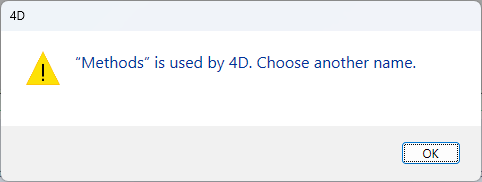

You can rename a folder by changing only the case of its name.

The folder menus of other editors list the same folders: the **in the folder** menu of [Find in design](../Project/search-replace.md#folder) and the **Folders** menu of the [Structure editor](structure-editor.md#highlightdim-tables-by-folder).

#### Qodly pages and lists

In a disk-folder project:

- Qodly pages are shown in the folders of the Home page. You can move them between folders like forms. Double-clicking a page opens it in Qodly Studio.
- The **Project Methods** list of the Methods page, and the **Project Forms** and **Qodly Pages** lists of the Forms page show their elements in the folder hierarchy: folders are expandable items, and Top Level elements are at the root. The other lists are unchanged.
- For an interpreted component that is a disk-folder project, the **Component Methods** list shows its shared methods in its folders (see [Editing components](../Extensions/develop-components.md#editing-components)).

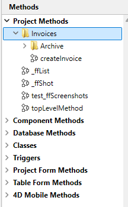

#### Changes made on disk

You can create, move, rename, or delete folders and element files outside 4D, for example with a git *pull*, VS Code, or an AI agent. 4D reloads the folder hierarchy from disk when the 4D application comes to the foreground, or when the [`RELOAD PROJECT`](../commands/reload-project) command is called. A method moved to another folder on disk keeps its open editors and breakpoints.

For example, you want to move the `createInvoice` method from the `Invoices` folder to its `Archive` subfolder outside the Explorer:

```4d
var $sources : 4D.Folder:=Folder(fk database folder).folder("Project/Sources")
var $target : 4D.Folder:=$sources.folder("Invoices/Archive/Methods")
$target.create()
$sources.file("Invoices/Methods/createInvoice.4dm").moveTo($target)
RELOAD PROJECT  // createInvoice is now in the Archive folder
```

#### Files at fault

Some files or folders found under `Sources` break the rules of disk-folder projects. 4D reports them when the project is opened and at each reload, with one of the following problems:

|Problem|Description|What 4D does|
|---|---|---|
|Duplicate element name|Two element files of the same type have the same name in different folders|None of the copies is loaded|
|Duplicate folder name|Two folders have the same name|Both folders are loaded with their content. Commands that take a folder name, such as [`METHOD GET PATHS`](../commands/method-get-paths), use the first folder in path order|
|Not in a type folder|An element file is not in a type folder (for example, `Sources/Invoices/doIt.4dm`)|The file is not loaded|
|Folder name over 31 characters|A folder name is longer than 31 characters|The folder is loaded with its content|

With the 4D IDE, the **Files at fault** dialog lists each path, relative to the project root folder (for example, `Project/Sources/DupA/Methods/doIt.4dm`), with its problem. Click **OK** to close the dialog: the project stays open. Fix the files on disk, then come back to 4D. The dialog is shown again only when the list has changed.

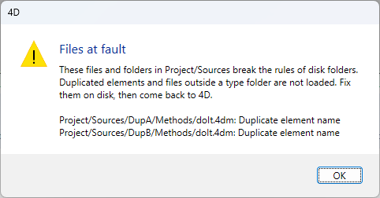

Without an IDE (4D Server, tool4d, or headless 4D), each path is written with its problem at the `Log error` level in the [diagnostic log](../Debugging/debugLogFiles.md#4ddiagnosticlogtxt), only when the diagnostic log is recording.

#### Converting a project

You can convert an existing project from virtual folders to disk folders, and back, with the following commands of the **Design** menu. Each command is available in 4D local mode only, depending on the current project model:

- **Convert to Disk Folders...**: each Home page folder becomes a folder in `Project/Sources` and `Documentation`, and the files of the methods, classes, forms, and Qodly pages it holds move into it. Empty folders are created. The `folders.json` file is deleted, the `"folder"` keys are removed from method files, and tables and table forms are placed in `tableFolders.json`. Each element goes to the folder shown on the Home page before the conversion.
- **Convert to Virtual Folders...**: the files of methods, classes, forms, and Qodly pages move back to the type folders at the root of `Project/Sources`, and documentation files go back to `Documentation/<type folder>`. Their folders are recorded in `folders.json` and in the `"folder"` key of method files, and `tableFolders.json` is deleted. Trash entries go back to `Trash/<type folder>`: of two deleted elements with the same name, only the most recent one is kept.

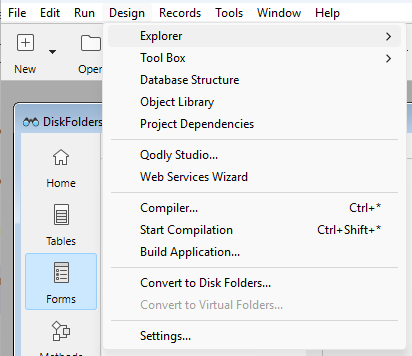

Open editors are saved first. A confirmation dialog describes the conversion: click **Convert** to proceed, or **Cancel** to leave the project unchanged. Commit or back up your project before converting.

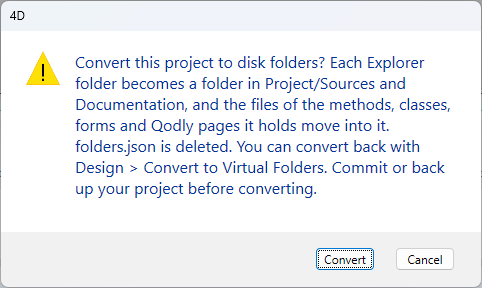

When converting to disk folders, folder names that can't be used on disk are renamed, on disk and on the Home page:

- each forbidden character is replaced by `_` (for example, `A:B` becomes `A_B`),
- a name used by 4D, a name reserved by the operating system, or the second of two names that differ only by case (in Home page order) gets a ` 2` suffix, or ` 3` if ` 2` is taken, and so on (for example, `Methods` becomes `Methods 2`, `CON` becomes `CON 2`, and `utils` becomes `utils 2` after `Utils`).

When folders are renamed, a dialog lists each old folder name with its new name.

If a file cannot be moved or written (for example, a locked or read-only file), the conversion stops, everything is undone, and 4D lists the files at fault. The project is never left half converted.


## Forms page

The Forms page contains three lists: **Project Forms**, **Table Forms**, and **Qodly Pages**. 


### Qodly Pages

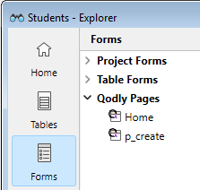

This section allows you to view the list of Qodly pages defined your project. You can also add or open pages. 


The pages listed in the Qodly Pages section are stored in the [**WebForm** subfolder](../Project/architecture.md#webforms) of the project's Sources folder.

:::note

Qodly pages are not visible in the **Home** page of the Explorer, except in [disk-folder projects](#disk-folders).

:::


### Requirements

Qodly pages are created and edited in [Qodly Studio](https://developer.4d.com/qodly/4DQodlyPro/qodlyStudioInterface), a web-based development tool. Accessing Qodly Studio from 4D requires some [specific configurations](https://developer.4d.com/qodly/4DQodlyPro/gettingStarted#requirements), that you [can set in one click](https://developer.4d.com/qodly/4DQodlyPro/gettingStarted#one-click-configuration). 

### Adding or opening a Qodly page

You can add or open Qodly pages directly from the 4D Explorer. If [requirements](#requirements) are met, the page is opened in the [Page editor of Qodly Studio](https://developer.4d.com/qodly/4DQodlyPro/pageLoaders/pageLoaderOverview). 

To add a page:

- Select **New Qodly page...** in the contextual menu, <br/>
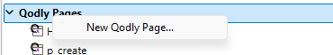

- or click the **+** icon or select **New Qodly page...** in the bottom area of the Explorer.<br/>
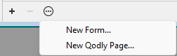

Enter the name of the page and click **OK** to open the page in Qodly Studio:

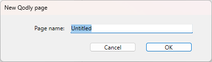


To open a page:

- double-click on a Qodly page name, or
- right-click on a Qodly page name and select **Edit...** in the contextual menu.


### Renaming or deleting a Qodly page

Renaming or deleting a Qodly page can only be done in the [Page editor of Qodly Studio](https://developer.4d.com/qodly/4DQodlyPro/pageLoaders/pageLoaderOverview).

Click on the pen icon to rename the page:<br/>
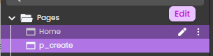

Click on the options button and select **Delete** to delete a page:<br/>
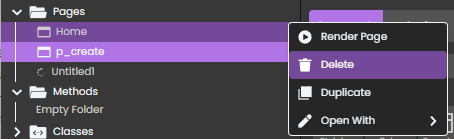

A confirmation dialog box is displayed. 


