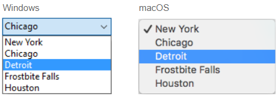
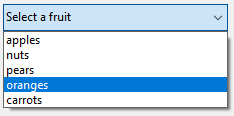
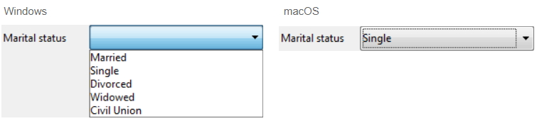
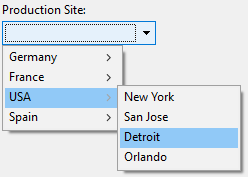

Drop-down lists are form objects that allow the user to select from a list. You manage the items displayed in the drop-down list using an object, an array, a choice list, or a standard action.

On macOS, drop-down lists are also sometimes called "pop-up menu". Both names refer to the same objects. As the following example shows, the appearance of these objects can differ slightly according to the platform:



## Drop-down list types

You can create different types of drop-down lists with different features. To define a type, select the appropriate **Expression Type** and **Data Type** values in the Property list, or use their JSON equivalent.

|Type|Features|Expression Type|Data Type|JSON definition|  
|---|---|---|---|---|
|Object|Built upon a collection|Object|Numeric, Text, Date, or Time|`dataSourceTypeHint: object` + `numberFormat: <format>` or `textFormat: <format>` or `dateFormat: <format>` or `timeFormat: <format>`|
|Array|Built upon an array|Array|Numeric, Text, Date, or Time|`dataSourceTypeHint: arrayNumber` or `arrayText` or `arrayDate` or `arrayTime`|
|Choice list saved as value|Built upon a choice list (standard)|List|Selected item value|`dataSourceTypeHint: text` + `saveAs: value`|
|Choice list saved as reference|Built upon a choice list. Item position is saved|List|Selected item reference|`dataSourceTypeHint: integer` + `saveAs: reference`|
|Hierarchical choice list|Can display hierarchical contents|List|List reference|`dataSourceTypeHint: integer`|
|Standard action|Automatically built by the action|*any*|*any except List reference*|any definition + `action: <action>` (+ `focusable: false` for actions applying to other areas)|

## Handling drop-down lists

### Using an object

> This feature is only available in 4D projects.

An [object](Concepts/dt_object.md) encapsulating a [collection](Concepts/dt_collection.md) can be used as the data source of a drop-down list. The object must contain the following properties:

|Property|Type|Description|
|---|---|---|
|`values`|Collection|Mandatory - Collection of scalar values. All values must be of the same type. Supported types:<li>strings</li><li>numbers</li><li>dates</li><li>times</li>If empty or not defined, the drop-down list is empty|
|`index`|number|Index of the currently selected item (value between 0 and `collection.length-1`). If you set -1, `currentValue` is displayed as a placeholder string|
|`currentValue`|same as Collection|Currently selected item (used as placeholder value if set by code)|

If the object contains other properties, they are ignored.

To initialize the object associated to the drop-down list, you can:

* Enter a list of default values in the object properties by selecting `\<Static List>` in the [Data Source](properties_DataSource.md) theme of the Property List. The default values are loaded into an object automatically.

* Execute code that creates the object and its properties. For example, if "myList" is the [variable](properties_Object.md#variable-or-expression) associated to the drop-down list, you can write in the [On Load](Events/onLoad.md) form event:

```4d
// Form.myDrop is the datasource of the form object
 
Form.myDrop:=New object
Form.myDrop.values:=New collection("apples"; "nuts"; "pears"; "oranges"; "carrots")
Form.myDrop.index:=-1  //currentValue is a placeholder
Form.myDrop.currentValue:="Select a fruit" 
```

The drop-down list is displayed with the placeholder string:


After the user selects a value:



```4d
Form.myDrop.values // ["apples","nuts","pears","oranges","carrots"]
Form.myDrop.currentValue //"oranges"
Form.myDrop.index //3
```

### Using an array

An [array](Concepts/arrays.md) is a list of values in memory that is referenced by the name of the array. A drop-down list can display an array as a list of values when you click on it.

To initialize the array associated to the drop-down list, you can:

* Enter a list of default values in the object properties by selecting `\<Static List>` in the [Data Source](properties_DataSource.md) theme of the Property List. The default values are loaded into an array automatically. You can refer to the array using the name of the variable associated with the object.

* Before the object is displayed, execute code that assigns values to the array elements. For example:

```4d
  ARRAY TEXT(aCities;6) 
  aCities{1}:="Philadelphia" 
  aCities{2}:="Pittsburg" 
  aCities{3}:="Grand Blanc" 
  aCities{4}:="Bad Axe" 
  aCities{5}:="Frostbite Falls" 
  aCities{6}:="Green Bay" 
```

In this case, the name of the [variable](properties_Object.md#variable-or-expression) associated with the object in the form must be `aCities`. This code could be placed in the form method and be executed when the `On Load` form event runs.
  
* Before the object is displayed, load the values of a list into the array using the [`LIST TO ARRAY`](../commands/list-to-array) command. For example:

```4d
   LIST TO ARRAY("Cities";aCities)
```

In this case also, the name of the [variable](properties_Object.md#variable-or-expression) associated with the object in the form must be `aCities`. This code would be run in place of the assignment statements shown above.

If you need to save the user’s choice into a field, you would use an assignment statement that runs after the record is accepted. The code might look like this:

```4d
  Case of
    :(Form event=On Load)
       LIST TO ARRAY("Cities";aCities)
       If(Record number([People])<0) //new record
          aCities:=3 //display a default value
       Else //existing record, display stored value
          aCities:=Find in array(aCities;City)
       End if
    :(Form event=On Clicked) //user modified selection
       City:=aCities{aCities} //field gets new value
    :(Form event=On Validate)
       City:=aCities{aCities}
    :(Form event=On Unload)
       CLEAR VARIABLE(aCities)
 End case
```
  
You must select each event that you test for in your Case statement. Arrays always contain a finite number of items. The list of items is dynamic and can be changed by a method. Items in an array can be modified, sorted, and added to.

### Using a choice list

If you want to use a drop-down list to manage the values of an input area (listed field or variable), 4D lets you reference the field or variable directly as the drop-down list's [data source](properties_Object.md#variable-or-expression). This makes it easier to manage listed fields/variables.

For example, in the case of a "Color" field that can only contain the values "White", "Blue", "Green" or "Red", it is possible to create a list containing these values and associate it with a drop-down list that references the 4D "Color" field. 4D then automatically takes care of managing the input and display of the current value in the form.

>If you use a hierarchical list, only the first level is displayed and can be selected. If you want to display hierarchical contents, you need to use a [hierarchical choice list](#using-a-hierarchical-choice-list).

To associate a drop-down list with a field or variable, enter the name of the field or variable directly as the [Variable or Expression](properties_Object.md#variable-or-expression) field of the drop-down list in the Property List.

>It is not possible to use this feature with an object or an array drop-down list. If you enter a field name in the "Variable or Expression" area, then you must use a choice list.

When the form is executed, 4D automatically manages the drop-down list during input or display: when a user chooses a value, it is saved in the field; this field value is shown in the drop-down list when the form is displayed:



#### Selected item value or Selected item reference

When you have associated a drop-down list with a choice list and with a field or a variable, you can set the [**Data Type**](properties_DataSource.md#data-type-list) property to **Selected item value** or **Selected item reference**. This option lets you optimize the size of the data saved.

### Using a hierarchical choice list

A hierarchical drop-down list has a sublist associated with each item in the list. Here is an example of a hierarchical drop-down list:



> In forms, hierarchical drop-down lists are limited to two levels.

You can assign the hierarchical choice list to the drop-down list object using the [Choice List](properties_DataSource.md#choice-list) field of the Property List.

You manage hierarchical drop-down lists using the **Hierarchical Lists** commands of the 4D Language. All commands that support the `(*; "name")` syntax can be used with hierarchical  drop-down lists, e.g. [`List item parent`](../commands/list-item-parent).

### Using a standard action

You can build automatically a drop-down list using a [standard action](properties_Action.md#standard-action). This feature is supported in the following contexts:

* Use of the `gotoPage` standard action. In this case, 4D will automatically display the [page of the form](FormEditor/forms.md#form-pages) that corresponds to the number of the item that is selected. For example, if the user selects the 3rd item, 4D will display the third page of the current form (if it exists). At runtime, by default the drop-down list displays the page numbers (1, 2...).  

* Use of a standard action that displays a sublist of items, for example `backgroundColor`. This feature requires that:
  * a styled text area ([4D Write Pro area](writeProArea_overview.md) or [input](input_overview.md) with [multistyle](properties_Text.md#multi-style) property) is present in the form as the standard action target.
  * the [focusable](properties_Entry.md#focusable) property is not set to the drop-down list.
At runtime the drop-down list will display an automatic list of values, e.g. background colors. You can override this automatic list by assigning in addition a choice list in which each item has been assigned a custom standard action.

> This feature cannot be used with a hierarchical drop-down list.

## Supported standard actions

The following actions are available in the drop-down list standard-action selector. See [Standard actions](../Desktop-legacy/standard-actions.md) and [4D Write Pro standard actions](../WritePro/user-legacy/standard-actions.md) for action descriptions and requirements.

[`gotoPage`](../Desktop-legacy/standard-actions.md#gotopage) - [`fontSize`](../Desktop-legacy/standard-actions.md#fontsize) - [`color`](../Desktop-legacy/standard-actions.md#color) - [`backgroundColor`](../WritePro/user-legacy/standard-actions.md#action-backgroundcolor) - [`textUnderlineStyle`](../WritePro/user-legacy/standard-actions.md#action-textunderlinestyle) - [`textUnderlineColor`](../WritePro/user-legacy/standard-actions.md#action-textunderlinecolor) - [`textLinethroughStyle`](../WritePro/user-legacy/standard-actions.md#action-textlinethroughstyle) - [`textLinethroughColor`](../WritePro/user-legacy/standard-actions.md#action-textlinethroughcolor) - [`textShadowOffset`](../WritePro/user-legacy/standard-actions.md#action-textshadowoffset) - [`textShadowColor`](../WritePro/user-legacy/standard-actions.md#action-textshadowcolor) - [`textTransform`](../WritePro/user-legacy/standard-actions.md#action-texttransform) - [`dpi`](../WritePro/user-legacy/standard-actions.md#action-dpi) - [`zoom`](../WritePro/user-legacy/standard-actions.md#action-zoom) - [`userUnit`](../WritePro/user-legacy/standard-actions.md#action-userunit) - [`pageMode`](../WritePro/user-legacy/standard-actions.md#action-pagemode) - [`pageSize`](../WritePro/user-legacy/standard-actions.md#action-pagesize) - [`tabDecimalSeparator`](../WritePro/user-legacy/standard-actions.md#action-tabdecimalseparator) - [`pageOrientation`](../WritePro/user-legacy/standard-actions.md#action-pageorientation) - [`section/pageOrientation`](../WritePro/user-legacy/standard-actions.md#action-pageorientation) - [`columnCount`](../WritePro/user-legacy/standard-actions.md#action-columncount) - [`section/columnCount`](../WritePro/user-legacy/standard-actions.md#action-columncount) - [`columnSpacing`](../WritePro/user-legacy/standard-actions.md#action-columnspacing) - [`section/columnSpacing`](../WritePro/user-legacy/standard-actions.md#action-columnspacing) - [`columnRuleStyle`](../WritePro/user-legacy/standard-actions.md#action-columnrulestyle) - [`section/columnRuleStyle`](../WritePro/user-legacy/standard-actions.md#action-columnrulestyle) - [`columnRuleColor`](../WritePro/user-legacy/standard-actions.md#action-columnrulecolor) - [`section/columnRuleColor`](../WritePro/user-legacy/standard-actions.md#action-columnrulecolor) - [`columnRuleWidth`](../WritePro/user-legacy/standard-actions.md#action-columnrulewidth) - [`section/columnRuleWidth`](../WritePro/user-legacy/standard-actions.md#action-columnrulewidth) - [`bookmark`](../WritePro/user-legacy/standard-actions.md#action-bookmark) - [`width`](../WritePro/user-legacy/standard-actions.md#action-width) - [`paragraph/width`](../WritePro/user-legacy/standard-actions.md#action-width) - [`image/width`](../WritePro/user-legacy/standard-actions.md#action-width) - [`column/width`](../WritePro/user-legacy/standard-actions.md#action-width) - [`image/height`](../WritePro/user-legacy/standard-actions.md#action-height) - [`row/height`](../WritePro/user-legacy/standard-actions.md#action-height) - [`minWidth`](../WritePro/user-legacy/standard-actions.md#action-minwidth) - [`paragraph/minWidth`](../WritePro/user-legacy/standard-actions.md#action-minwidth) - [`image/minWidth`](../WritePro/user-legacy/standard-actions.md#action-minwidth) - [`minHeight`](../WritePro/user-legacy/standard-actions.md#action-minheight) - [`paragraph/minHeight`](../WritePro/user-legacy/standard-actions.md#action-minheight) - [`image/minHeight`](../WritePro/user-legacy/standard-actions.md#action-minheight) - [`margin`](../WritePro/user-legacy/standard-actions.md#action-margin) - [`doc/margin`](../WritePro/user-legacy/standard-actions.md#action-margin) - [`paragraph/margin`](../WritePro/user-legacy/standard-actions.md#action-margin) - [`paragraph/inside/margin`](../WritePro/user-legacy/standard-actions.md#action-margin) - [`paragraph/outside/margin`](../WritePro/user-legacy/standard-actions.md#action-margin) - [`image/margin`](../WritePro/user-legacy/standard-actions.md#action-margin) - [`section/margin`](../WritePro/user-legacy/standard-actions.md#action-margin) - [`header/margin`](../WritePro/user-legacy/standard-actions.md#action-margin) - [`footer/margin`](../WritePro/user-legacy/standard-actions.md#action-margin) - [`table/margin`](../WritePro/user-legacy/standard-actions.md#action-margin) - [`padding`](../WritePro/user-legacy/standard-actions.md#action-padding) - [`doc/padding`](../WritePro/user-legacy/standard-actions.md#action-padding) - [`paragraph/padding`](../WritePro/user-legacy/standard-actions.md#action-padding) - [`paragraph/inside/padding`](../WritePro/user-legacy/standard-actions.md#action-padding) - [`paragraph/outside/padding`](../WritePro/user-legacy/standard-actions.md#action-padding) - [`image/padding`](../WritePro/user-legacy/standard-actions.md#action-padding) - [`section/padding`](../WritePro/user-legacy/standard-actions.md#action-padding) - [`header/padding`](../WritePro/user-legacy/standard-actions.md#action-padding) - [`footer/padding`](../WritePro/user-legacy/standard-actions.md#action-padding) - [`cell/padding`](../WritePro/user-legacy/standard-actions.md#action-padding) - [`column/padding`](../WritePro/user-legacy/standard-actions.md#action-padding) - [`doc/backgroundColor`](../WritePro/user-legacy/standard-actions.md#action-backgroundcolor) - [`paragraph/backgroundColor`](../WritePro/user-legacy/standard-actions.md#action-backgroundcolor) - [`image/backgroundColor`](../WritePro/user-legacy/standard-actions.md#action-backgroundcolor) - [`section/backgroundColor`](../WritePro/user-legacy/standard-actions.md#action-backgroundcolor) - [`header/backgroundColor`](../WritePro/user-legacy/standard-actions.md#action-backgroundcolor) - [`footer/backgroundColor`](../WritePro/user-legacy/standard-actions.md#action-backgroundcolor) - [`table/backgroundColor`](../WritePro/user-legacy/standard-actions.md#action-backgroundcolor) - [`row/backgroundColor`](../WritePro/user-legacy/standard-actions.md#action-backgroundcolor) - [`cell/backgroundColor`](../WritePro/user-legacy/standard-actions.md#action-backgroundcolor) - [`column/backgroundColor`](../WritePro/user-legacy/standard-actions.md#action-backgroundcolor) - [`backgroundPositionH`](../WritePro/user-legacy/standard-actions.md#action-backgroundpositionh) - [`doc/backgroundPositionH`](../WritePro/user-legacy/standard-actions.md#action-backgroundpositionh) - [`paragraph/backgroundPositionH`](../WritePro/user-legacy/standard-actions.md#action-backgroundpositionh) - [`image/backgroundPositionH`](../WritePro/user-legacy/standard-actions.md#action-backgroundpositionh) - [`section/backgroundPositionH`](../WritePro/user-legacy/standard-actions.md#action-backgroundpositionh) - [`header/backgroundPositionH`](../WritePro/user-legacy/standard-actions.md#action-backgroundpositionh) - [`footer/backgroundPositionH`](../WritePro/user-legacy/standard-actions.md#action-backgroundpositionh) - [`table/backgroundPositionH`](../WritePro/user-legacy/standard-actions.md#action-backgroundpositionh) - [`row/backgroundPositionH`](../WritePro/user-legacy/standard-actions.md#action-backgroundpositionh) - [`cell/backgroundPositionH`](../WritePro/user-legacy/standard-actions.md#action-backgroundpositionh) - [`column/backgroundPositionH`](../WritePro/user-legacy/standard-actions.md#action-backgroundpositionh) - [`backgroundPositionV`](../WritePro/user-legacy/standard-actions.md#action-backgroundpositionv) - [`doc/backgroundPositionV`](../WritePro/user-legacy/standard-actions.md#action-backgroundpositionv) - [`paragraph/backgroundPositionV`](../WritePro/user-legacy/standard-actions.md#action-backgroundpositionv) - [`image/backgroundPositionV`](../WritePro/user-legacy/standard-actions.md#action-backgroundpositionv) - [`section/backgroundPositionV`](../WritePro/user-legacy/standard-actions.md#action-backgroundpositionv) - [`header/backgroundPositionV`](../WritePro/user-legacy/standard-actions.md#action-backgroundpositionv) - [`footer/backgroundPositionV`](../WritePro/user-legacy/standard-actions.md#action-backgroundpositionv) - [`table/backgroundPositionV`](../WritePro/user-legacy/standard-actions.md#action-backgroundpositionv) - [`row/backgroundPositionV`](../WritePro/user-legacy/standard-actions.md#action-backgroundpositionv) - [`cell/backgroundPositionV`](../WritePro/user-legacy/standard-actions.md#action-backgroundpositionv) - [`column/backgroundPositionV`](../WritePro/user-legacy/standard-actions.md#action-backgroundpositionv) - [`backgroundRepeat`](../WritePro/user-legacy/standard-actions.md#action-backgroundrepeat) - [`doc/backgroundRepeat`](../WritePro/user-legacy/standard-actions.md#action-backgroundrepeat) - [`paragraph/backgroundRepeat`](../WritePro/user-legacy/standard-actions.md#action-backgroundrepeat) - [`image/backgroundRepeat`](../WritePro/user-legacy/standard-actions.md#action-backgroundrepeat) - [`section/backgroundRepeat`](../WritePro/user-legacy/standard-actions.md#action-backgroundrepeat) - [`header/backgroundRepeat`](../WritePro/user-legacy/standard-actions.md#action-backgroundrepeat) - [`footer/backgroundRepeat`](../WritePro/user-legacy/standard-actions.md#action-backgroundrepeat) - [`table/backgroundRepeat`](../WritePro/user-legacy/standard-actions.md#action-backgroundrepeat) - [`row/backgroundRepeat`](../WritePro/user-legacy/standard-actions.md#action-backgroundrepeat) - [`cell/backgroundRepeat`](../WritePro/user-legacy/standard-actions.md#action-backgroundrepeat) - [`column/backgroundRepeat`](../WritePro/user-legacy/standard-actions.md#action-backgroundrepeat) - [`backgroundClip`](../WritePro/user-legacy/standard-actions.md#action-backgroundclip) - [`doc/backgroundClip`](../WritePro/user-legacy/standard-actions.md#action-backgroundclip) - [`paragraph/backgroundClip`](../WritePro/user-legacy/standard-actions.md#action-backgroundclip) - [`image/backgroundClip`](../WritePro/user-legacy/standard-actions.md#action-backgroundclip) - [`section/backgroundClip`](../WritePro/user-legacy/standard-actions.md#action-backgroundclip) - [`header/backgroundClip`](../WritePro/user-legacy/standard-actions.md#action-backgroundclip) - [`table/backgroundClip`](../WritePro/user-legacy/standard-actions.md#action-backgroundclip) - [`row/backgroundClip`](../WritePro/user-legacy/standard-actions.md#action-backgroundclip) - [`cell/backgroundClip`](../WritePro/user-legacy/standard-actions.md#action-backgroundclip) - [`column/backgroundClip`](../WritePro/user-legacy/standard-actions.md#action-backgroundclip) - [`backgroundOrigin`](../WritePro/user-legacy/standard-actions.md#action-backgroundorigin) - [`doc/backgroundOrigin`](../WritePro/user-legacy/standard-actions.md#action-backgroundorigin) - [`paragraph/backgroundOrigin`](../WritePro/user-legacy/standard-actions.md#action-backgroundorigin) - [`image/backgroundOrigin`](../WritePro/user-legacy/standard-actions.md#action-backgroundorigin) - [`section/backgroundOrigin`](../WritePro/user-legacy/standard-actions.md#action-backgroundorigin) - [`header/backgroundOrigin`](../WritePro/user-legacy/standard-actions.md#action-backgroundorigin) - [`footer/backgroundOrigin`](../WritePro/user-legacy/standard-actions.md#action-backgroundorigin) - [`table/backgroundOrigin`](../WritePro/user-legacy/standard-actions.md#action-backgroundorigin) - [`row/backgroundOrigin`](../WritePro/user-legacy/standard-actions.md#action-backgroundorigin) - [`cell/backgroundOrigin`](../WritePro/user-legacy/standard-actions.md#action-backgroundorigin) - [`column/backgroundOrigin`](../WritePro/user-legacy/standard-actions.md#action-backgroundorigin) - [`backgroundSizeH`](../WritePro/user-legacy/standard-actions.md#action-backgroundsizeh) - [`doc/backgroundSizeH`](../WritePro/user-legacy/standard-actions.md#action-backgroundsizeh) - [`paragraph/backgroundSizeH`](../WritePro/user-legacy/standard-actions.md#action-backgroundsizeh) - [`image/backgroundSizeH`](../WritePro/user-legacy/standard-actions.md#action-backgroundsizeh) - [`section/backgroundSizeH`](../WritePro/user-legacy/standard-actions.md#action-backgroundsizeh) - [`header/backgroundSizeH`](../WritePro/user-legacy/standard-actions.md#action-backgroundsizeh) - [`footer/backgroundSizeH`](../WritePro/user-legacy/standard-actions.md#action-backgroundsizeh) - [`table/backgroundSizeH`](../WritePro/user-legacy/standard-actions.md#action-backgroundsizeh) - [`row/backgroundSizeH`](../WritePro/user-legacy/standard-actions.md#action-backgroundsizeh) - [`cell/backgroundSizeH`](../WritePro/user-legacy/standard-actions.md#action-backgroundsizeh) - [`column/backgroundSizeH`](../WritePro/user-legacy/standard-actions.md#action-backgroundsizeh) - [`backgroundSizeV`](../WritePro/user-legacy/standard-actions.md#action-backgroundsizev) - [`doc/backgroundSizeV`](../WritePro/user-legacy/standard-actions.md#action-backgroundsizev) - [`paragraph/backgroundSizeV`](../WritePro/user-legacy/standard-actions.md#action-backgroundsizev) - [`image/backgroundSizeV`](../WritePro/user-legacy/standard-actions.md#action-backgroundsizev) - [`section/backgroundSizeV`](../WritePro/user-legacy/standard-actions.md#action-backgroundsizev) - [`header/backgroundSizeV`](../WritePro/user-legacy/standard-actions.md#action-backgroundsizev) - [`footer/backgroundSizeV`](../WritePro/user-legacy/standard-actions.md#action-backgroundsizev) - [`table/backgroundSizeV`](../WritePro/user-legacy/standard-actions.md#action-backgroundsizev) - [`row/backgroundSizeV`](../WritePro/user-legacy/standard-actions.md#action-backgroundsizev) - [`cell/backgroundSizeV`](../WritePro/user-legacy/standard-actions.md#action-backgroundsizev) - [`column/backgroundSizev`](../WritePro/user-legacy/standard-actions.md#action-backgroundsizev) - [`borderStyle`](../WritePro/user-legacy/standard-actions.md#action-borderstyle) - [`doc/borderStyle`](../WritePro/user-legacy/standard-actions.md#action-borderstyle) - [`paragraph/borderStyle`](../WritePro/user-legacy/standard-actions.md#action-borderstyle) - [`paragraph/inside/borderStyle`](../WritePro/user-legacy/standard-actions.md#action-borderstyle) - [`paragraph/outside/borderStyle`](../WritePro/user-legacy/standard-actions.md#action-borderstyle) - [`image/borderStyle`](../WritePro/user-legacy/standard-actions.md#action-borderstyle) - [`section/borderStyle`](../WritePro/user-legacy/standard-actions.md#action-borderstyle) - [`header/borderStyle`](../WritePro/user-legacy/standard-actions.md#action-borderstyle) - [`footer/borderStyle`](../WritePro/user-legacy/standard-actions.md#action-borderstyle) - [`table/borderStyle`](../WritePro/user-legacy/standard-actions.md#action-borderstyle) - [`row/borderStyle`](../WritePro/user-legacy/standard-actions.md#action-borderstyle) - [`cell/borderStyle`](../WritePro/user-legacy/standard-actions.md#action-borderstyle) - [`column/borderStyle`](../WritePro/user-legacy/standard-actions.md#action-borderstyle) - [`borderColor`](../WritePro/user-legacy/standard-actions.md#action-bordercolor) - [`doc/borderColor`](../WritePro/user-legacy/standard-actions.md#action-bordercolor) - [`paragraph/borderColor`](../WritePro/user-legacy/standard-actions.md#action-bordercolor) - [`paragraph/inside/borderColor`](../WritePro/user-legacy/standard-actions.md#action-bordercolor) - [`paragraph/outside/borderColor`](../WritePro/user-legacy/standard-actions.md#action-bordercolor) - [`image/borderColor`](../WritePro/user-legacy/standard-actions.md#action-bordercolor) - [`section/borderColor`](../WritePro/user-legacy/standard-actions.md#action-bordercolor) - [`header/borderColor`](../WritePro/user-legacy/standard-actions.md#action-bordercolor) - [`footer/borderColor`](../WritePro/user-legacy/standard-actions.md#action-bordercolor) - [`table/borderColor`](../WritePro/user-legacy/standard-actions.md#action-bordercolor) - [`row/borderColor`](../WritePro/user-legacy/standard-actions.md#action-bordercolor) - [`cell/borderColor`](../WritePro/user-legacy/standard-actions.md#action-bordercolor) - [`column/borderColor`](../WritePro/user-legacy/standard-actions.md#action-bordercolor) - [`borderWidth`](../WritePro/user-legacy/standard-actions.md#action-borderwidth)- [`doc/borderWidth`](../WritePro/user-legacy/standard-actions.md#action-borderwidth) - [`paragraph/borderWidth`](../WritePro/user-legacy/standard-actions.md#action-borderwidth) - [`paragraph/inside/borderWidth`](../WritePro/user-legacy/standard-actions.md#action-borderwidth) - [`paragraph/outside/borderWidth`](../WritePro/user-legacy/standard-actions.md#action-borderwidth) - [`image/borderWidth`](../WritePro/user-legacy/standard-actions.md#action-borderwidth) - [`section/borderWidth`](../WritePro/user-legacy/standard-actions.md#action-borderwidth) - [`header/borderWidth`](../WritePro/user-legacy/standard-actions.md#action-borderwidth) - [`footer/borderWidth`](../WritePro/user-legacy/standard-actions.md#action-borderwidth) - [`table/borderWidth`](../WritePro/user-legacy/standard-actions.md#action-borderwidth) - [`row/borderWidth`](../WritePro/user-legacy/standard-actions.md#action-borderwidth) - [`cell/borderWidth`](../WritePro/user-legacy/standard-actions.md#action-borderwidth) - [`column/borderWidth`](../WritePro/user-legacy/standard-actions.md#action-borderwidth) - [`borderRadius`](../WritePro/user-legacy/standard-actions.md#action-borderradius) - [`doc/borderRadius`](../WritePro/user-legacy/standard-actions.md#action-borderradius) - [`paragraph/borderRadius`](../WritePro/user-legacy/standard-actions.md#action-borderradius) - [`image/borderRadius`](../WritePro/user-legacy/standard-actions.md#action-borderradius) - [`section/borderRadius`](../WritePro/user-legacy/standard-actions.md#action-borderradius) - [`header/borderRadius`](../WritePro/user-legacy/standard-actions.md#action-borderradius) - [`footer/borderRadius`](../WritePro/user-legacy/standard-actions.md#action-borderradius) - [`direction`](../WritePro/user-legacy/standard-actions.md#action-direction) - [`textAlign`](../WritePro/user-legacy/standard-actions.md#action-textalign) - [`lineHeight`](../WritePro/user-legacy/standard-actions.md#action-lineheight) - [`listStyleType`](../WritePro/user-legacy/standard-actions.md#action-liststyletype) - [`listStartNumber`](../WritePro/user-legacy/standard-actions.md#action-liststartnumber) - [`listNumberFormat`](../WritePro/user-legacy/standard-actions.md#action-listnumberformat) - [`textIndent`](../WritePro/user-legacy/standard-actions.md#action-textindent) - [`verticalAlign`](../WritePro/user-legacy/standard-actions.md#action-verticalalign) - [`image/verticalAlign`](../WritePro/user-legacy/standard-actions.md#action-image-verticalalign) - [`cell/verticalAlign`](../WritePro/user-legacy/standard-actions.md#action-verticalalign) - [`column/verticalAlign`](../WritePro/user-legacy/standard-actions.md#action-verticalalign) - [`tableAlign`](../WritePro/user-legacy/standard-actions.md#action-tablealign) - [`table/tableAlign`](../WritePro/user-legacy/standard-actions.md#action-tablealign) - [`emptyDatasource`](../WritePro/user-legacy/standard-actions.md#action-emptydatasource) - [`table/emptyDatasource`](../WritePro/user-legacy/standard-actions.md#action-emptydatasource) - [`styleSheet`](../WritePro/user-legacy/standard-actions.md#action-stylesheet) - [`paragraph/styleSheet`](../WritePro/user-legacy/standard-actions.md#action-stylesheet) - [`image/styleSheet`](../WritePro/user-legacy/standard-actions.md#action-stylesheet) - [`newLineStyleSheet`](../WritePro/user-legacy/standard-actions.md#action-newlinestylesheet) - [`anchorLayout`](../WritePro/user-legacy/standard-actions.md#action-anchorlayout) - [`anchorHorizontalAlign`](../WritePro/user-legacy/standard-actions.md#action-anchorhorizontalalign) - [`anchorVerticalAlign`](../WritePro/user-legacy/standard-actions.md#action-anchorverticalalign) - [`anchorOrigin`](../WritePro/user-legacy/standard-actions.md#action-anchororigin) - [`anchorSection`](../WritePro/user-legacy/standard-actions.md#action-anchorsection) - [`anchorPage`](../WritePro/user-legacy/standard-actions.md#action-anchorpage) - [`image/displayMode`](../WritePro/user-legacy/standard-actions.md#action-image-displaymode) - [`backgroundDisplayMode`](../WritePro/user-legacy/standard-actions.md#action-backgrounddisplaymode) - [`doc/backgroundDisplayMode`](../WritePro/user-legacy/standard-actions.md#action-backgrounddisplaymode) - [`paragraph/backgroundDisplayMode`](../WritePro/user-legacy/standard-actions.md#action-backgrounddisplaymode) - [`image/backgroundDisplayMode`](../WritePro/user-legacy/standard-actions.md#action-backgrounddisplaymode) - [`section/backgroundDisplayMode`](../WritePro/user-legacy/standard-actions.md#action-backgrounddisplaymode) - [`header/backgroundDisplayMode`](../WritePro/user-legacy/standard-actions.md#action-backgrounddisplaymode) - [`footer/backgroundDisplayMode`](../WritePro/user-legacy/standard-actions.md#action-backgrounddisplaymode) - [`table/backgroundDisplayMode`](../WritePro/user-legacy/standard-actions.md#action-backgrounddisplaymode) - [`row/backgroundDisplayMode`](../WritePro/user-legacy/standard-actions.md#action-backgrounddisplaymode) - [`cell/backgroundDisplayMode`](../WritePro/user-legacy/standard-actions.md#action-backgrounddisplaymode) - [`column/backgroundDisplayMode`](../WritePro/user-legacy/standard-actions.md#action-backgrounddisplaymode) - [`formulaHighlight`](../WritePro/user-legacy/standard-actions.md#action-formulahighlight) - [`formulaHighlightColor`](../WritePro/user-legacy/standard-actions.md#action-formulahighlightcolor) - [`headerRowCount`](../WritePro/user-legacy/standard-actions.md#action-headerrowcount)

:::note

For automatic text-formatting lists, see [Using a standard action](#using-a-standard-action) for target-area and focus requirements, and the restriction on hierarchical drop-down lists. The text-formatting target-area and focus requirements do not apply to `gotoPage`.

Actions assigned to individual choice-list items are separate from the action assigned to the drop-down list.

:::

See the [standard action compatibility table](../Desktop-legacy/standard-actions.md#supported-form-objects).

## Supported Properties

[Alpha Format](properties_Display.md#alpha-format) - [Bold](properties_Text.md#bold) - [Bottom](properties_CoordinatesAndSizing.md#bottom) - [Choice List](properties_DataSource.md#choice-list) - [Class](properties_Object.md#css-class) - [Data Type (expression type)](properties_DataSource.md#data-type-expression-type) - [Data Type (list)](properties_DataSource.md#data-type-list) - [Date Format](properties_Display.md#date-format) - [Expression Type](properties_Object.md#expression-type) - [Focusable](properties_Entry.md#focusable) - [Font](properties_Text.md#font) - [Font Color](properties_Text.md#font-color) - [Font Size](properties_Text.md#font-size) - [Height](properties_CoordinatesAndSizing.md#height) - [Help Tip](properties_Help.md#help-tip) - [Horizontal Alignment](properties_Text.md#horizontal-alignment) - [Horizontal Sizing](properties_ResizingOptions.md#horizontal-sizing) - [Italic](properties_Text.md#italic) - [Left](properties_CoordinatesAndSizing.md#left) - [Not rendered](properties_Display.md#not-rendered) - [Object Name](properties_Object.md#object-name) - [Right](properties_CoordinatesAndSizing.md#right) - [Standard action](properties_Action.md#standard-action) - [Save value](properties_Object.md#save-value) - [Time Format](properties_Display.md#time-format) - [Top](properties_CoordinatesAndSizing.md#top) - [Type](properties_Object.md#type) - [Underline](properties_Text.md#underline) - [Variable or Expression](properties_Object.md#variable-or-expression) - [Vertical Sizing](properties_ResizingOptions.md#vertical-sizing) - [Visibility](properties_Display.md#visibility) - [Width](properties_CoordinatesAndSizing.md#width)  

## Supported Events

[On After Edit](../Events/onAfterEdit.md) - [On After Keystroke](../Events/onAfterKeystroke.md) - [On Before Keystroke](../Events/onBeforeKeystroke.md) - [On Begin Drag Over](../Events/onBeginDragOver.md) - [On Clicked](../Events/onClicked.md) - [On Data Change](../Events/onDataChange.md) - [On Drag Over](../Events/onDragOver.md) - [On Drop](../Events/onDrop.md) - [On Header](../Events/onHeader.md) - [On Load](../Events/onLoad.md) - [On Mouse Enter](../Events/onMouseEnter.md) - [On Mouse Leave](../Events/onMouseLeave.md) - [On Mouse Move](../Events/onMouseMove.md) - [On Printing Break](../Events/onPrintingBreak.md) - [On Printing Detail](../Events/onPrintingDetail.md) - [On Printing Footer](../Events/onPrintingFooter.md) - [On Unload](../Events/onUnload.md) - [On Validate](../Events/onValidate.md)

