Utiliza el editor de estructuras para administrar la estructura de base de datos, las tablas y sus relaciones. Le da control sobre las tablas, propiedades de la tabla, campos, propiedades del campo incluyendo índices, y relaciones de la tabla.

Puede acceder al **Editor de estructuras** eligiendo el comando **Estructura de la base de datos** en el menú **Diseño** o haciendo clic en el botón de estructura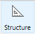 en la barra de herramientas 4D.

El editor de estructuras proporciona una vista gráfica de la estructura de una base de datos así como una barra de herramientas y menús contextuales que puede utilizar para realizar operaciones de diseño de bases de datos. Cada tabla es representada por una imagen de tabla. Muestra los campos y sus tipos en forma de iconos. Una barra de información muestra las características de las tablas y campos a medida que el ratón se mueve sobre ellas.

Una **paleta Inspector** flotante puede ser usada para ver y modificar las propiedades de los objetos de estructura y del propio editor de estructuras. Esta ventana se describe en la sección [Paleta del Inspector](#inspector-palette).

## Toolbar (Barra de herramientas)

El editor de estructura tiene una barra de herramientas que contiene funciones como la adición de objetos, así como opciones de navegación y visualización:

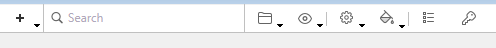

De izquierda a derecha, los iconos realizan las siguientes acciones:

- añadir objetos (tablas, campos, índices, relaciones)
- buscar en el editor
- ocultar/mostrar tablas según las carpetas definidas en la página de inicio del Explorador
- mostrar filtros
- Herramientas (tamaño, alineación, ordenación)
- colores
- Ventana de la lista de índices
- Gestor de llaves primarias

### Información sobre el bloqueo

Si el archivo de estructura está bloqueado se muestra un icono de candado cerrado 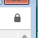.  
El bloqueo puede ocurrir tanto en los modos proyecto y cliente/servidor cuando:

- El archivo `catalog.4DCatalog` está en *solo lectura* (solo para proyectos). Al hacer clic en el icono del candado, aparecerá un aviso para desbloquearlo, si es posible.
- Dos o más usuarios intentan modificar la misma estructura al mismo tiempo. La estructura no se puede utilizar hasta que el primer usuario la libere cerrando la ventana. *(Cliente/servidor únicamente)*

En ambos casos, la estructura se puede abrir en modo *solo lectura*, pero no se puede utilizar hasta que se elimine el bloqueo.

## Barra de información

La parte inferior de la ventana del editor es una barra de información que muestra datos correspondientes al elemento sobre el que se encuentra el cursor: tabla, campo o relación.

#### Información sobre una tabla

- Nombre y número de la tabla
- Triggers de la tabla:
  - **NEW:** al guardar un nuevo registro
  - **SAVE:** al guardar un registro existente
  - **DEL:** al eliminar un registro

#### Información sobre un campo

- Nombre y número de la tabla
- Nombre y número del campo
- Tipo de campo
- Atributos del campo:
  - **NUL:** traducir los valores null a valores vacíos
  - **UNI:** único

#### Información sobre una relación

- Tabla y campo de origen (campo Muchos)
- Tabla y campo de destino (campo Uno)
- Tipo de relación y nombre ORDA:
  - **N→1** (de Muchos a Uno) y el nombre del atributo relacional `relatedEntities`
  - **1→ N** (Uno a Muchos) y nombre del atributo relacional `relatedEntity`

:::note

Para más información sobre los nombres ORDA, consulte la página [Objetos del modelo de datos](../ORDA/dsMapping.md#structure-mapping).

:::

## Paleta Inspector

Las propiedades de los objetos del editor de estructuras (tablas, campos y relaciones) se pueden consultar y modificar a través de la paleta Inspector:

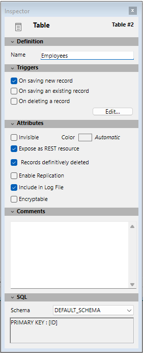

Esta paleta aparece al hacer doble clic en un objeto. Cuando se muestra, su contenido se actualiza dinámicamente en función de los objetos seleccionados. El Inspector muestra las [propiedades generales de la ventana del editor de estructuras](#customizing-the-editor-window) al hacer clic en un área vacía de la ventana.

Las diferentes áreas de la paleta pueden ser desplegadas/contraídas. Puede hacer clic en los triángulos adyacentes para mostrar u ocultar la información correspondiente.

Se pueden utilizar los siguientes atajos:

- **Mayús+clic** en la barra de título de un panel contraído despliega ese panel y contrae todos los demás.
- **Alt** (Windows) u **Opción** (macOS) + **clic** en la barra de título de un panel colapsado abre todos los paneles.
- **Alt** (Windows) u **Opción** (macOS) + **clic** en la barra de título de un panel desplegado permite contraer todos los paneles.

La posición de la paleta y los estados desplegados/contraídos de sus paneles se guardan.

## Seleccionar un objeto

Para trabajar con la imagen de un objeto en el editor de estructura, primero debe seleccionarlo. Luego puede especificar sus propiedades, moverla, redimensionarla, eliminarla, etc. Puede seleccionar varios objetos del mismo tipo simultáneamente para modificar sus propiedades comunes en la paleta Inspector.

Para seleccionar:

- **Una tabla:** haga clic en la imagen de la tabla, o presione `Tab` / `Mayús+Tab` para seleccionar cada tabla sucesivamente.
- **Un campo o relación:** haga clic en el campo o relación, o utilice las teclas de flecha para navegar.
- **Varios objetos:** utilice `Mayús + clic` para los objetos adyacentes y `Ctrl + clic` (Windows) o `Comando + clic` (macOS) para los que no lo sean.

## Trabajar con imágenes de tablas

Puede cambiar el tamaño o mover las imágenes de la tabla en el editor de estructuras de acuerdo con sus necesidades.

**4D Server**: en [modo desarrollo](../Desktop/clientServer.md#development-mode), cualquier modificación en las imágenes de las tablas (cambio de tamaño, ubicación...) se propaga a todos los desarrolladores en el entorno Diseño.

### Desplazarse por la lista de campos

Cuando añade campos a una tabla o cuando reduce el tamaño de una tabla, es posible que haya más campos en la tabla de los que puede mostrar la imagen. Cuando esto sucede, 4D añade automáticamente un cursor que lo que puede utilizar para desplazarse a través de la lista de campos visibles:

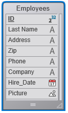

### Redimensionar una imagen de tabla

Puede cambiar el tamaño de una imagen de tabla para mostrar más nombres de campos o reorganizar su pantalla.

- **Redimensionamiento manual**: solo tiene que hacer clic y arrastrar la parte inferior de la imagen de la tabla o su esquina inferior derecha.

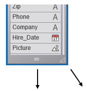

- **Tamaño óptimo**: esta opción ajusta automáticamente el tamaño de las tablas seleccionadas para que corresponda exactamente con el número de campos que contienen (no se muestran líneas vacías). Para aplicar el comando **Tamaño óptimo** a una o más tablas, seleccione **Tamaño óptimo** en el menú asociado con el botón de la barra de herramientas del editor o desde el menú contextual del editor (haga clic en una tabla).

- **Contraer**: la función **Contraer** contrae las imágenes de las tablas seleccionadas, de modo que solo queden visibles sus nombres.  Esto es útil para estructuras grandes.

Para aplicar el comando **Contraer** a una o varias tablas, puede:

 ```
 - Seleccionar **Contraer** en el menú contextual del editor (haga clic en el área del título de la tabla).  
 - **Mayús+ doble clic** en el área del nombre de la tabla para alternar entre la misma secuencia: *tamaño original → contraer.*
 ```

:::note Notas

- Un doble clic estándar en el área de nombre de la tabla abre el **Inspector**.
- **Alt** (Windows) u **Opción** (macOS) + doble clic abre el método de activación de la tabla en el **Editor de métodos**.
- **Ctrl** (Windows) o **Comando** (macOS) + doble clic abre el **Explorador** en la página Formulario.

:::

### Desplazamiento de las imágenes de tabla

Puede mover las imágenes de las tablas para reagruparlas según su función o para reorganizar la ventana del editor de estructura. También puede alinearlos para mejorar la legibilidad de la estructura. Todas las relaciones se vuelven a trazar automáticamente para que se ajusten a las nuevas ubicaciones de las tablas.

Para mover manualmente la imagen de una tabla, haga clic en el nombre de la tabla y arrástrela con el cursor. Arrastre únicamente la barra del nombre de la tabla. Si arrastra otras partes de la imagen de la tabla, pueden producirse efectos diferentes, como crear una nueva relación de tabla o cambiar el tamaño de la imagen de la tabla.

Para alinear dos o más tablas, seleccione las tablas a alinear y elija una opción de alineación en el menú de herramientas:

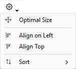

Estos comandos solo están activos cuando se han seleccionado al menos dos tablas.

## Desplazamiento

Las funciones específicas de desplazamiento facilitan la navegación por estructuras de gran tamaño:

- La rueda del ratón se puede utilizar para desplazarse verticalmente por el contenido de la ventana del editor. Esto también permitirá desplazarse por los campos de una tabla cuando se sitúe el cursor sobre ella.
- Mantener presionado **Mayús** mientras se usa la rueda del ratón desplaza el contenido de la ventana horizontalmente.
- Presionando **Mayús** se activa la herramienta "mano" que puede utilizarse para arrastrar todo el contenido de la ventana haciendo clic en el área vacía.

## Zoom

Puede modificar la escala de visualización de la estructura de la base de datos usando el menú **Zoom** al lado derecho de la barra de información. 100% es el valor predeterminado al abrir una base de datos. La acción de zoom se centra en la selección, si hay alguna.

El ajuste actual del zoom es específico para cada usuario y se guarda al cerrar la ventana.

:::note

Puede [configurar la representación gráfica del editor de estructuras al hacer zoom](../Preferences/structure.md#graphic-quality-of-the-structure) mediante una opción de configuración.

:::

## Mostrar tipo de objeto

El botón **Visualizar** de la barra de herramientas del editor de estructuras está vinculado a un menú y permite seleccionar los objetos que se mostrarán en la estructura según su tipo:

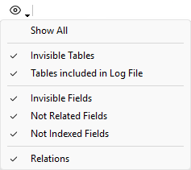

Por defecto, se muestran todos los objetos. Esta funcionalidad permite diversas representaciones o vistas, desde las más sencillas hasta las más completas, y ofrece una herramienta de análisis de la estructura en función del nivel de información requerido.

Las opciones se aplican a todas las tablas y campos. Se guardan por usuario y se memorizan al cerrar la ventana. Ocultar objetos no modifica la posición de las tablas.

- Cuando se seleccionan varios tipos de campos, se utiliza un operador OR lógico para determinar los objetos a mostrar. Por ejemplo, si se marcan *Campos Invisibles* y *Campos no Indexados*, todos los campos no indexados e invisibles (indexados o no) se mostrarán.
- Las tablas tienen prioridad sobre los campos: si una tabla no se muestra, tampoco se muestran sus campos.
- Si añade un objeto cuyo tipo no se muestra (tabla, campo o relación), se hace visible. Para volver a ocultarlo, debe desmarcar la opción correspondiente en el menú **Visualización**.

## Resaltar/Ocultar las tablas por carpeta

Puede ocultar grupos de tablas en el Editor de estructura según las carpetas definidas en la **página de inicio** de la ventana del Explorador. Puede configurar esta pantalla usando el botón **Carpetas** en la barra de herramientas del editor de estructuras.

El menú asociado a este botón muestra los comandos que permiten gestionar la visualización, así como la lista de carpetas de la base de datos. Aparece una marca de verificación junto a cada carpeta que se muestra. Puede modificar la visualización actual seleccionando o deseleccionando una carpeta de este menú.

Los comandos **Mostrar todas las carpetas** y **Ocultar todas las carpetas** permiten mostrar u ocultar todas las tablas de las carpetas de la base de datos.

Cada vez que se presiona el botón de la carpeta de la barra de herramientas, se invierte la visualización de las tablas: las tablas resaltadas se atenuaron y viceversa.

Cuando las tablas están atenuadas, solo aparecen sus contornos en la ventana de estructura. Las tablas que no aparecen atenuadas siguen siendo totalmente visibles.

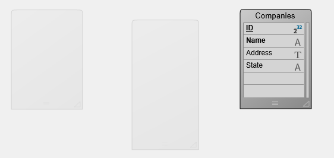

:::note

Puede definir la apariencia de las tablas atenuadas en el editor de estructura para que aparezcan como *Atenuadas* o *Invisibles* mediante una [opción de la página **Estructura** de las Preferencias](../Preferences/structure.md#when-a-folder-is-dimmed-its-contents-are). Es necesario cerrar y volver a abrir la ventana del editor de estructuras para que esta configuración surta efecto.

:::

## Personalizar la ventana del editor

La ventana del editor de estructuras tiene propiedades específicas que se pueden configurar usando el **Inspector**.

Para mostrar estas propiedades, puede:

- Haga doble clic (o haga clic, si la ventana ya está mostrada) en un área vacía de la ventana, o
- Haga clic derecho en un área vacía y elija **Propiedades de estructura** en el menú contextual.

La paleta Inspector muestra las propiedades de la estructura.

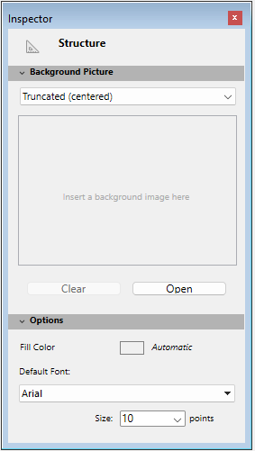

Se pueden definir las siguientes propiedades:

- **Background Picture:** You can add or modifiy the background picture used as well as its display format. To add or modify the picture, click on the **Open** button or right-click in the preview area and choose **Open** from the context menu; then select the file containing the picture to be displayed. You can use any picture format. The selected picture is displayed immediately in the preview area and in the editor window.
  To change the display format of the picture, choose a value from the Picture Format menu. The formats provided are the standard picture display formats of 4D.
  To delete a custom picture, click on the **Clear** button or right-click in the preview area and choose **Clear** from the context menu.
- **Fill Color:** You can change the color used for the background of the editor window. To do this, click in the color selection area and choose a color from the selection menu.
- **Default Font:** To change the default font used for table and field names, choose a value from this menu. You can also use the Size menu to change the default font size.

## Buscar en la estructura

4D lets you carry out searches directly in the Structure editor window. Searches can be among the following elements:

- Table names and/or field names
- Table numbers

To perform a search, enter a text or table number in the **Search** field of the Structure editor. As you type, a bar appears below where you can specify search options:

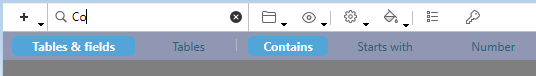

- **Scope**: *Tables & fields* or *Tables* (i.e. tables only).
- **Types**:
  - *Contains* (default): typing "le" finds "Table", "Letter", etc.
  - *Starts with*: typing "pa" finds "paper", "paid", but not "repair".
  - *Number*: typing "2" finds tables numbered 2, 12, 20, etc.

Searches are performed in real time as you type. Tables and fields that match are highlighted. If nothing is found, the search area turns red. To exit **Search** mode, click the **X** button in the search bar or delete all the characters in the search area.

