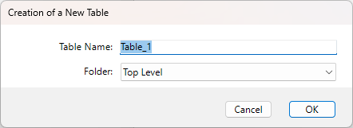

Las tablas son la base de cada base de datos 4D. Cada tabla define una colección de registros que comparten el mismo conjunto de campos y propiedades. En el editor de estructuras, las tablas se representan como objetos gráficos que puede crear, renombrar o eliminar, y cuyos atributos puede configurar individualmente.

Utilizando las herramientas proporcionadas por 4D, puede:

- Definir tablas y administrar sus llaves y relaciones primarias
- Definir y editar propiedades a nivel de tabla como triggers, visibilidad y replicación
- Controlar las reglas de nombres y organizar las tablas en carpetas para facilitar el mantenimiento

## Creación de una tabla

Puede crear una nueva tabla directamente en la ventana de la estructura, o a través de un cuadro de diálogo. La creación directa es más rápida; pero la creación usando el cuadro de diálogo le permite especificar ciertos parámetros de la tabla y cancelar la operación cuando sea necesario. También puede crear tablas usando copiar y pegar.

- Para crear una nueva tabla directamente:

1. Haga clic derecho en un área vacía de la ventana del editor de estructuras, luego seleccione **Agregar tabla...** en el menú contextual.  
   **O**  
   En el menú añadir objetos de la [Barra de herramientas del editor de estructuras](./structure-editor.md#toolbar), elija la opción Tabla.

4D crea la tabla directamente en el editor de estructuras. A continuación, puede cambiar su nombre, añadir campos, etc.

:::note

Si quiere poner la tabla en una carpeta específica, necesita usar la Página principal del Explorador.

:::

- Para crear una nueva tabla usando el cuadro de diálogo "Nueva tabla":

1. Elija **Nueva > Tabla...** en el menú **Archivo** (o en el botón **Nuevo** de la barra de herramientas 4D).  
   **O**  
   En la página de tablas del explorador, haga clic en el botón **\[+]**.

Aparece el cuadro de diálogo "Nueva tabla". 4D nombra la primera tabla `Table_1` y luego los números secuencialmente:

2. (opcional) Modifica el [nombre de la tabla](../Concepts/identifiers.md#tables-and-fields) que quiere crear.
3. (opcional) Especifique la carpeta en la que desea colocar la nueva tabla.  
   De forma predeterminada, la tabla se coloca en el nivel más alto de la jerarquía de carpetas ("Nivel superior"). Las carpetas se gestionan en la página principal del explorador.
4. Haga clic en **OK** para validar.  
   4D crea una nueva imagen de tabla. Se convierte en la imagen de tabla seleccionada en la ventana del editor de estructuras.

- Para crear una nueva tabla copiando y pegando:

1. Seleccione y copie la(s) tabla(s) a duplicar.
2. Pegue la(s) tabla(s) en la ventana del editor de estructuras.

La tabla se pega con todos sus campos y propiedades.

## Renombrar una tabla

Puede renombrar tablas en cualquier momento. Si ha utilizado el nombre de tabla antiguo en un método, 4D lo cambia automáticamente al nuevo nombre siempre que el método esté cerrado. Si el método está abierto, debe hacer los cambios usted mismo. Cada nombre de tabla debe ser único en la base de datos.

Puede renombrar una tabla directamente en el editor de estructuras, en el explorador, o usando la paleta Inspector.

Para renombrar una tabla directamente (Editor de estructura o página Tablas del Explorador), **haga clic dos veces** en el nombre de la tabla (si la tabla ya está seleccionada, haga clic una vez) para que pase al modo de edición:

Introduzca el nuevo nombre y haga clic fuera de la tabla.

Para renombrar una tabla usando la paleta Inspector del editor de estructuras, haga doble clic en el nombre de la tabla (o seleccione **Propiedades de la tabla..** en el menú contextual de la tabla) e introduzca el nuevo nombre en el área "Nombre".

4D muestra el nombre y las propiedades de la tabla seleccionada en la paleta Inspector. Esta paleta también indica el número de la tabla. Si la paleta Inspector ya está abierta pero muestra las propiedades de otra tabla u otro objeto, sólo tiene que seleccionar la imagen de la tabla deseada y la paleta mostrará sus propiedades.

## Eliminando una tabla

Puede eliminar tablas de su base de datos. Hay dos maneras de borrar tablas en 4D: **eliminación permanente** (la tabla y sus datos son realmente eliminados de la base de datos) y **eliminación no permanente** (la tabla simplemente se pone en la Papelera del Explorador y puede ser recuperada de forma continua).

:::info

También puede eliminar tablas usando el [motor SQL de 4D](https://doc.4d.com/4Dv21/4D/21/4D-SQL-Reference.100-7649299.en.html).

:::

### Eliminación permanente

Para eliminar permanentemente una o más tablas de la base de datos en el editor de estructuras:

Seleccione la(s) tabla(s) a eliminar, luego elija **Limpiar** del menú **Editar** o elija **Eliminar** en el menú contextual de la tabla.

Un cuadro de diálogo de advertencia le pedirá que confirme la operación. Cuando haga clic en **OK**, 4D realiza las siguientes operaciones:

- La tabla se elimina permanentemente de la estructura. Todos los datos asociados a la tabla se eliminan permanentemente del archivo de datos.
- Cualquier método de activación asociado con la tabla se elimina.
- Los formularios y las listas asociadas a la tabla se transforman en formularios de proyecto y se colocan en la papelera del Explorador.

### Eliminación no permanente

La eliminación no permanente de una tabla consiste en ponerla en la papelera del proyecto (al que se puede acceder a través del Explorador), al igual que los mecanismos de eliminación de archivos implementados por Windows y macOS.

La tabla entonces ya no aparece en los editores 4D y su contenido se vuelve inaccesible, pero todavía se puede recuperar siempre y cuando no se vacíe la Papelera.

Para mover una o varias tablas a la Papelera desde el Editor de estructura, elija el comando Mover a la Papelera en el menú contextual de la tabla o seleccione las tablas que desea eliminar y presione la tecla **Suprimir** o **Retroceso**. Aparece un cuadro de diálogo de confirmación. Si hace clic en **OK**, la tabla pasa a la papelera. Se puede recuperar en cualquier momento desde la Página Papelera del Explorador.

### Números de tablas eliminadas

Cuando se elimina una tabla, las otras tablas de la base de datos no se renumeran, para evitar poner en peligro la estabilidad de la base de datos. Por lo tanto, es posible, por ejemplo, tener una base de datos con tres tablas numeradas 2, 4 y 5.

Tenga en cuenta que los números de tablas eliminadas permanentemente se reutilizan cuando las nuevas tablas se crean de forma simultánea.

## Propiedades de la tabla

Puede configurar varias propiedades para tablas usando la **paleta Inspector** o, para ciertas propiedades, usando el menú contextual de las tablas.

### Triggers

Una [trigger](./triggers) es un método que se ejecuta automáticamente cuando ocurren ciertos eventos relacionados con la tabla. Los eventos trigger pueden establecerse en la **paleta Inspector** o utilizando el menú contextual asociado con la tabla (clic derecho en el área de título de la tabla). Revise cada evento para el cual quiere [activar el trigger](./triggers#activating-and-creating-a-trigger).

Puede acceder al trigger de una tabla directamente desde el editor de estructuras haciendo clic en la **Editar. .** botón en la paleta Inspector o seleccionando **Editar método...** en el submenú contextual. También puede crear y mostrar triggers con la **página Métodos** del Explorador.

La [barra de información](./structure-editor.md#information-bar) del **Editor de estructuras** indica los triggers que están activados para cada tabla.

### Atributos

Puede establecer diferentes atributos para configurar la apariencia y el comportamiento general de cada tabla.

#### Invisible

Esta opción le permite hacer una tabla invisible en el modo Aplicación y para plug-ins. Puede activar esta opción para tablas auxiliares o tablas que no se utilicen temporalmente.

Hacer invisible una tabla le permite limitar las operaciones que un usuario puede realizar en una tabla haciendo que la tabla y sus campos sean invisibles en todos los editores y algunos cuadros de diálogo que aparecen en el entorno de la aplicación. Tampoco puede ser utilizado por plug-ins.

Los editores y los cuadros de diálogo correspondientes en el entorno de la aplicación incluyen lo siguiente:

- Todos los editores de consulta
- Ordenar por editor
- [Editor de etiquetas](../Desktop/labels.md)
- Editor de informes rápidos
- Cuadros de diálogo para exportar e importar datos
- Editor de fórmulas

En cada uno de estos editores, el usuario no puede ver o elegir la tabla o cualquiera de sus campos. Por ejemplo, el usuario no puede incluir ningún campo de una tabla invisible en un informe o etiqueta.

:::note Notas

- Al utilizar estos editores, los usuarios tienen la opción de guardar sus especificaciones (por ejemplo, la consulta o ordenación que crearon) en los archivos de disco. En este caso, todas las tablas o campos especificados que posteriormente se hagan invisibles pueden ser utilizados en la operación.
- Los usuarios pueden escribir los nombres de las tablas invisibles y los campos en el cuadro de diálogo.
- También es posible establecer este atributo para cada campo individualmente.

:::

Las tablas y campos invisibles se muestran en *cursiva* en la ventana del editor de estructuras.

#### Color de la imagen de la tabla

Un color puede ser atribuido a cada tabla. Usar colores ayuda a organizar la estructura de una gran base de datos. Por ejemplo, puede usar un color para todas las tablas que se relacionan con los clientes y otra para tablas que se relacionan con el inventario.

:::note

También es posible atribuir un color a cada campo individualmente, así como a cada relación.

:::

Para establecer el color de una o más tablas, haga su selección y luego elija el color utilizando:

- El botón **Color** de la barra de herramientas del editor de estructuras
- El comando **Color** en el menú contextual de las tablas
- La opción **Color** en la **paleta Inspector**

La opción **Automática** puede utilizarse para aplicar el color original estándar a la tabla.

#### Exponer como recurso REST

Esta opción controla si la [tabla está expuesta a solicitudes REST](../REST/configuration.md#exposing-tables).

:::note Notas

- También puede establecer esta opción en el nivel de cada campo de la tabla.
- Esta opción se utiliza en el contexto de las [funcionalidades de almacenamiento remoto de ORDA](../ORDA/remoteDatastores.md).

:::

#### Registros eliminados definitivamente

Esta opción le permite optimizar la eliminación de una selección de registros realizados utilizando el comando [`DELETE SELECTION`](../commands/delete-selection).

Cuando 4D elimina una selección, los marcadores de registro también se eliminan. Un marcador de registro es un encabezado adjunto al registro que contiene información relacionada con este registro. Eliminar marcadores y registros es más lento que eliminar sólo registros. En algunos casos, puede ser deseable no eliminar automáticamente los marcadores de registro.

Para acelerar el borrado de una selección grande hecha utilizando el comando [`DELETE SELECCION`](../commands/delete-selection), anule la selección de **Registros definitivamente eliminados**. No se eliminarán los marcadores de registro. Esta opción no puede ser definida por programación.

#### Habilitar replicación

:::info Obsoleto

Los mecanismos de replicación y sincronización usando SQL están obsoletos a partir de 4D 20 R3. Todavía son soportados, pero ahora se recomienda usar la [función de sello global basado en ORDA](../ORDA/global-stamp.md), proporcionando una solución flexible y robusta para implementar replicación y sincronización en 4D.

:::

#### Incluída en el archivo de registro

De forma predeterminada, esta opción se marca para todas las nuevas tablas creadas y para todas las tablas en bases de datos convertidas. Marque esta opción para que las operaciones realizadas en los datos de la tabla sean incluidas en el [archivo de registro de la base de datos](../Backup/log.md) (cuando se genere).

Esta opción generalmente debe ser chequeada para la mayoría de las tablas. Sin embargo, para fines de optimización, puede desmarcarlo, por ejemplo para tablas temporales o tablas utilizadas para importar datos.

Es importante tener en cuenta que esta opción sólo indica que los datos de la tabla deben ser almacenados si la base de datos utiliza un archivo de registro; no permite el procedimiento diario de transacciones en sí mismo a nivel de base de datos.

:::note Notas

- Esta opción se graba cuando la tabla no tiene una llave primaria.
- 4D muestra un icono de advertencia a la derecha de la opción **Incluir en archivo de registro** cuando no se cumplen las condiciones requeridas. Mientras se muestre este icono, el diario de transacciones aún no está habilitado.

:::

#### Cifrable

Esta opción controla si los datos almacenados en la tabla deben ser cifrados en el disco cuando [el cifrado del archivo de datos está habilitado](../MSC/encrypt.md).

Dado que el cifrado/descifrado puede llevar mucho tiempo, seleccionar las tablas para cifrar le permite optimizar el rendimiento de las bases de datos cifradas. Por ejemplo, sólo se pueden establecer las tablas que contienen datos personales como **Encriptable**.

Tenga en cuenta que esta opción marca tabla(s); no realiza ninguna operación de cifrado o descifrado. Para cifrar o descifrar tabla(s) seleccionadas en el archivo de datos, debe usar el comando [MSC](../MSC/encrypt.md) o llamar al [`Encrypt data file`](../commands/encrypt-data-file).

:::warning

- Cuando modifica el valor de esta opción para una tabla en una base de datos ya cifrada, también debe usar el comando [MSC](../MSC/encrypt.md) o llamar a [`Encrypt data file`](../commands/encrypt-data-file) para preservar la consistencia de los datos. De lo contrario, no se le permitirá guardar datos en la tabla modificada (los errores serán devueltos por 4D al intentar guardar registros).
- El cifrado de datos almacenados fuera del archivo de datos no es administrado por esta opción.

:::

### Comentarios

El área **Comentarios** de la **paleta Inspector** le permite almacenar información adicional sobre la tabla. Estos comentarios están disponibles para todos los desarrolladores. Tenga en cuenta que cada campo y cada relación tiene su propio área de comentarios.

### SQL

- El menú "Esquemas" lista todos los esquemas SQL especificados en la base de datos. Puede usar este menú para establecer el esquema al que pertenecerá la tabla (también es posible modificar esta propiedad mediante comandos SQL). Cada base de datos tiene al menos un esquema, llamado **DEFAULT_SCHEMA**. Por defecto, todas las tablas pertenecen a este esquema. Para obtener más información sobre esquemas SQL, consulte la [sección **Esquemas**](https://doc.4d.com/4Dv21/4D/21/4D-SQL-engine-implementation.300-7649386.en.html#148386) en la guía de referencia *4D SQL*.
- El área de información indica si el nombre de la tabla respeta las reglas relativas a la nomenclatura SQL (por ejemplo, a diferencia de 4D, SQL no permite que un nombre de campo contenga espacios).

### Llaves primarias

Una llave primaria designa los campo(s) utilizados para identificar de forma única los registros en una tabla. Definir una llave primaria es necesario para las [funcionalidades del registro](../Backup/log.md).

Cree, edite y/o elimine las llaves primarias directamente usando el menú contextual del editor de estructuras o el [Administrador de llaves primarias](#primary-key-manager).

> **Nota:** las llaves primarias también pueden establecerse usando el lenguaje SQL mediante la cláusula **PRIMARY KEY** seguida por la lista de columnas.

#### Reglas para el uso de campos llave primaria

Los campos llave primaria deben manejarse con cuidado para garantizar la integridad de los datos en todo momento. En particular, un campo llave primaria debe respetar las siguientes reglas:

- no debe estar vacío,
- debe ser único,
- una vez creado, (en principio) nunca debe ser modificado, especialmente si:
  - [funcionalidades de sello global](../ORDA/global-stamp.md) están habilitadas,
  - [funcionalidad REST (o similar)](../REST/gettingStarted.md) está habilitada,
  - la base de datos se sincroniza periódicamente (copia de seguridad o réplica lógica usando el [archivo de registro](../Backup/log.md)).

Modificar el valor del campo llave primaria es altamente desaconsejado, incluso si 4D lo permite para casos de uso específicos.  
Si es absolutamente necesario modificar un valor de llave primaria (p.e. ha usado un campo de número de seguridad social como llave primaria y se han introducido valores incorrectos), es preferible deshabilitar (eliminar) la llave primaria actual y añadir un nuevo campo usado como llave primaria con asignación automática.

Los campos llave primaria pueden ser de tipo entero largo o formato UUID (tipo alfa). En la mayoría de los casos, recomendamos el formato UUID con la opción Auto UUID activada. Aunque el tipo entero largo ocupa menos espacio en disco, los UUIDs tienen muchas ventajas, por ejemplo, facilitando la fusión de bases de datos independientes, importación/exportación de datos, implementación de estrategias elaboradas de réplica/replicación o sincronización con sistemas externos.

#### Configurando llaves primarias

Para crear una llave primaria desde el editor de estructuras:

1. Seleccione los campos que componen la llave primaria de la tabla.
2. Haga clic derecho y elija **Crear llave primaria** en el menú contextual (este comando sólo se muestra para campos cuyo tipo es elegible para las llaves primarias).

No puede tener más de una llave primaria para cada tabla. If a primary key is already specified, a warning dialog box appears indicating that the existing primary key will first be disabled.

La llave primaria se crea inmediatamente. Los campos incluidos en la llave primaria están *subrayados* en el editor y su descripción SQL muestra la palabra clave **PRIMARY KEY**.

Cuando crea una llave primaria en una tabla que ya contiene registros (usando un campo existente o agregando uno nuevo), 4D comprueba la conformidad de todos los valores presentes o realiza automáticamente operaciones de actualización:

- Los campo(s) pertenecientes a la llave primaria no pueden contener ningún valor duplicado. Si existen valores duplicados para la llave en los registros de la tabla, un cuadro de diálogo de advertencia parece indicar que no es posible crear la llave por esta razón.
- Si los valores duplicados están en blanco o son nulos (como en el caso de un campo clave añadido), puede marcar la opción de generación automática correspondiente (para campos Alpha o para campos Entero largo).  
  En este caso, 4D examina todos los registros de la tabla y asigna automáticamente un valor calculado a cada llave primaria. Note that this process is sequential and may require a significant amount of time if there are a sizable number of records.

> **Note:** The column(s) belonging to the primary key do not accept NULL values.

#### Removing primary keys

To remove a primary key from a table:

1. Right-click on the table containing the primary key and choose **Remove primary key** in the context menu.
   Aparece un cuadro de diálogo de confirmación. Click **OK** to remove the primary key.

#### Default primary key field

Every new table created in the database contains a primary key by default. This field, named **"ID"** by default, is of the Longint type, and has, in particular, the following attributes:

- Unique,
- Reject NULL value input,
- Autoincrement,
- Automatic index.

You can use this field as is, or change its name and/or its properties if you want (for example, you may want to use an UUID field). You can also delete it if you want to use another field (or fields) as primary key(s). However, it is strongly recommended to keep at least one primary key in each 4D table.

:::note

In the [Structure page of the Preferences](../Preferences/structure.md), you can modify the name and type of the primary keys that are created by default.

:::

:::info

Default primary keys are not added to tables that are created using the SQL **CREATE TABLE** command, or tables that are imported into the database.

:::

## Primary key manager

The **Primary key manager** is an assistant intended to facilitate the resolution of errors related to the presence of tables without primary keys, particularly in the context of a journaled database:

You can use this assistant to:

- diagnose the compatibility of each database table with the 4D journaling mechanism,
- propose a correction for each table found that is not compatible, more particularly by creating a primary key.

### Accessing assistant

There are two ways to display the **Primary key manager** window:

- From the **Primary key error window**: click on the **Run assistant** button to display the assistant window.

**Note:** The Primary key manager is displayed in Design mode. If the database starts in Application mode, the assistant does not appear right away and you will need to switch to Design mode.

- From the **Structure editor**: click on the button in the [toolbar](./structure-editor.md#toolbar) of this window to display the assistant.

### Using the assistant

The **Primary key manager** window displays a line for every table in the database:

The assistant does not take tables placed in the Trash into account.

The icon at the head of each line indicates whether the table requires the attention of the user:

| Icono                                  | Estado                                               | Descripción                                                                                                                                                                                                                                                               |
| -------------------------------------- | ---------------------------------------------------- | ------------------------------------------------------------------------------------------------------------------------------------------------------------------------------------------------------------------------------------------------------------------------- |
|  | OK                                                   | A valid primary key is set for the table.                                                                                                                                                                                                                 |
|  | No primary key, eligible field(s) | The table does not have a primary key but contains at least one field that could become the primary key.                                                                                                                                                  |
|  | No primary key, no eligible fields                   | The table does not have a primary key and does not have any fields that could become one (you will have to create a primary key field).                                                                                                |
|  | Atención                                             | The table does not have a primary key but it is not journaled ("Include in Log File" option disabled for the table). It is possible to hide tables that have this status by unchecking the option to display warnings. |

For each journaled table that does not have a primary key, the assistant displays a menu to set the action to be performed. You can choose from the following options:

- **Ignore:** does not modify the table. The errors are not corrected and the status of the table is not changed. Use this option if you wish to intervene later, or if you want to create the primary key outside of the assistant. This option is necessary in particular when you want to create a primary key based on several fields in the table.

- **Use existing field** (only shown for tables with at least one field eligible to be a primary key): designates one of the table fields as the primary key. When you choose this option, the assistant suggests the most appropriate field by default. If you want to use another field or if the assistant fails to identify a particularly suitable field (the assistant displays *Select a field*), click on the second menu in the row to display the list of eligible fields.

- **Create a new field:** creates a new primary key field in the table. This field will have the same characteristics as the one [added by default when a new table is created](#default-primary-key-field). By default, the assistant proposes to create a field of the Longint type, named “ID”. You can modify the name and type of default primary key fields in the [Preferences](../Preferences/structure.md#primary-key). You can also change the name and/or type of the field directly in the Primary key manager window.

- **Do not log this table:** unchecks the [**Include in Log File**](#include-in-log-file) option for the table. You can choose this option in the case of temporary tables. After you validate this dialog box, a “Warning” status is assigned to the table.

Once you have made your settings, click on **Apply...** to apply the changes to the database or **Close** to close the dialog box without modifying the database. When you click on **Apply...**, a confirmation dialog box appears listing the operations to be performed; you can either confirm or cancel the operation.

If you have designated existing fields as primary keys, 4D checks each table to make sure that its existing data respects the rules concerning uniqueness and null values for this type of field. If, for example, a field contains duplicate values or null values, an error is generated. You will need to find and remove these anomalies before you can enable journaling for the data.

:::note

In order to facilitate the correction of errors related to primary keys, the primary key values are displayed in the [**Activity analysis** page of the Maintenance and Security Center](../MSC/analysis.md).

:::
