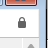
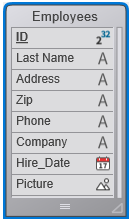
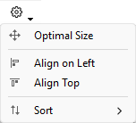
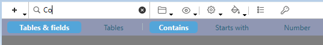

ストラクチャーエディターを使用してデータベースストラクチャー (テーブルとリレーション) を管理できます。このエディターを使用してテーブル、テーブルプロパティ、フィールド、フィールドプロパティ、インデックスやテーブルリレーションを管理できます。

**ストラクチャーエディター**には**デザイン**メニューの**データベースストラクチャー**コマンドを選択するか、4Dツールバーのストラクチャーボタン  をクリックすることでアクセスできます。

ストラクチャーエディターはデータベースストラクチャーをグラフィカルに表示し、データベースデザイン操作に使用するツールバーやコンテキストメニューを提供します。エディター内では、それぞれのテーブルはテーブルイメージとして表現されます。テーブルにはフィールドとその型がアイコンで表示されます。マウスを重ねると、情報バーにテーブルやフィールドの情報が表示されます。

フローティングパレット上に表示される**インスペクターパレット**を使用して、ストラクチャーオブジェクトやストラクチャーエディター自身のプロパティを表示したり変更したりできます。このウィンドウについては[インスペクターパレット](#インスペクターパレット) の章で説明します。

## ツールバー

ストラクチャーエディターにはオブジェクト追加などの機能、およびナビゲーションや表示オプションを格納するツールバーがあります:


左から右へ順に、アイコンは以下のアクションを実行します:

- オブジェクト(テーブル、フィールド、インデックス、リレーション)の追加
- エディター内を検索
- エクスプローラーのホームページ内で定義されたフォルダに基づいてテーブルの表示/非表示を切り替える
- フィルターを表示
- ツール (サイズ、配置、並べ替え)
- カラー
- インデックス一覧ウィンドウ
- プライマリーキー(主キー)マネージャー

### ロック情報

ストラクチャーファイルがロックされている時には、閉じた南京錠のアイコン  が表示されます。  
ロックは、プロジェクトモードおよびクライアント/サーバーモードの両方において、以下ような場合に起こり得ます:

- `catalog.4DCatalog` ファイルが*読み出し専用* であるとき(プロジェクトモードのみ)。南京錠のアイコンをクリックすると、可能である場合にはそれを解錠するアラートが表示されます。
- 2人以上のユーザーが同じストラクチャーを同時に編集しようとしたとき。ストラクチャーは、最初のユーザーがウィンドウを閉じて解放するまで使用することができません。*(クライアント/サーバーモードのみ)*

どちらのケースにおいても、設定は *読み取り専用* として開くことはできますが、ロックが解除されるまでは使用することができません。

## 情報バー

エディターウィンドウの下部にはマウスが重なっているオブジェクトのエリアに対応する情報を表示する情報バーがあります:テーブル、フィールド、リレーション。

#### テーブルに関する情報

- テーブル名とテーブル番号
- テーブルトリガ:
  - **NEW:** 新規レコード保存時
  - **SAVE:** 既存レコード保存時
  - **DEL:** レコード削除時

#### フィールドに関する情報

- テーブル名とテーブル番号
- フィールド名とフィールド番号
- フィールドの型
- フィールド属性:
  - **NUL:** 空値にヌル値をマップ
  - **UNI:** 重複不可

#### リレーションに関する情報

- リレーション元のテーブルとフィールド(Nフィールド)
- リレーション先のテーブルとフィールド(1フィールド)
- リレーションの種類とORDA 名:
  - **N→1** (N対1) および `relatedEntities` リレーション属性名
  - **1→N** (1対N) および `relatedEntity` リレーション属性名

:::note

ORDA 名についての詳細な情報に関しては、[データモデルオブジェクト](../ORDA/dsMapping.md#structure-mapping) のページを参照して下さい。

:::

## インスペクターパレット

ストラクチャーエディターオブジェクト (テーブル、フィールド、リレーション) のプロパティはインスペクターパレットに表示し編集することができます:


このパレットはオブジェクト上でダブルクリックすると表示されます。表示されているとき、表示内容は選択されたオブジェクトに基づきダイナミックに更新されます。ウィンドウの空のエリアをクリックすると、[インスペクターにはストラクチャーエディターの一般的なプロパティ](#エディターウィンドウのカスタマイズ) が表示されます。

パレットの異なるエリアは、パネルごとに展開・折りたたみができます。すぐとなりの三角形をクリックすることで対応する情報を表示、または非表示にすることができます。

以下のショートカットが使用することができます:

- 折りたたまれたパネルのタイトルバーを**Shift+クリック**すると、そのパネルを展開し、他を折りたたみます。
- 折りたたまれたパネルのタイトルバーを**Alt** (Windows) または**Option** (macOS) + **クリック**すると、すべてのパネルを展開します。
- 展開されたパネルのタイトルバーを**Alt** (Windows) または**Option** (macOS) + **クリック**すると、すべてのパネルを折りたたみます。

パレットの位置とパネルの展開/折りたたみ状態は保存されます。

## オブジェクトを選択する

ストラクチャーエディター中のオブジェクトのイメージを操作するには、まずそれを選択します。そしてそのプロパティを定義したり、移動したり、サイズ変更したり、削除したりできます。同時に同じタイプのオブジェクトを複数選択して、例えばインスペクターパレットで共通のプロパティを表示し、変更することができます。

選択の仕方は以下の通りです:

- **テーブル:** テーブルイメージをクリックする、または `Tab` / `Shift+Tab` を押して、ストラクチャーエディター中のテーブルを移動しながら選択します。
- **フィールドまたはリレーション:** フィールドまたはリレーション上をクリックする、または矢印キーを押して移動する。
- **複数のオブジェクト:** 連続した(隣り合った)オブジェクトを選択するには`Shift+Click` を、連続していないオブジェクトを選択するには`Ctrl+Click` (Windows) または `Command+Click` (macOS) を使用します。

## テーブルイメージを操作する

必要に応じて、ストラクチャーエディター中でテーブルイメージのサイズを変更したり移動したりできます。

**4D Server**: [開発モード](../Desktop/clientServer.md#開発モード) でテーブルイメージをサイズ変更(リサイズや位置の変更など)すると、すべてのユーザーのデザインモードでテーブルイメージサイズが変更されます。

### Scrolling the field list

When you add fields to a table or when you reduce the size of a table, there may be more fields in the table than the image can display. When this happens, 4D automatically adds a cursor than you can use to scroll through the list of visible fields:



### Resizing a table image

You can resize a table image to display more field names or reorganize your screen.

- **Manual resizing**: Simply click and drag the bottom of the table image or its lower right corner.


- **Optimal Size**: This option automatically resizes the selected table(s) so that their size corresponds exactly to the number of fields they contain (no empty lines are displayed). To apply the **Optimal Size** command to one or more tables, select **Optimal Size** from the menu associated with the toolbar button of the editor or from the editor’s context menu (click on a table).

- **Collapse**: The **Collapse** function collapses the selected table image(s) so that only their names are visible.  This is useful for large structures.

To apply the **Collapse** command to one or more tables, you can:

 ```
 - Select **Collapse** from the editor’s context menu (click in the title area of the table).  
 - **Shift+Double-click** in the table name area to toggle through the same sequence *original size → collapse.*
 ```

:::note 注記

- A standard double-click on the table name area opens the **Inspector**.
- **Alt** (Windows) or **Option** (macOS) + double-click opens the trigger method of the table in the **Method editor**.
- **Ctrl** (Windows) or **Command** (macOS) + double-click opens the **Explorer** on the Form page.

:::

### Moving table images

You can move table images to regroup them according to function or to reorganize the Structure editor window. You can also align them to improve the readability of the structure. Any relations are redrawn automatically to correspond with the new table locations.

To move a table image manually, click on the name of a table and drag it using the mouse cursor. Drag the table name bar only. Dragging other parts of the table image may produce different effects, such as creating a new table relation or changing the size of the table image.

To align two or more tables, select the tables to align and choose an alignment option in the tools menu:



These commands are only active when at least two tables are selected.

## Scrolling

Specific scrolling functions facilitate navigation among large structures:

- The mouse wheel can be used to scroll the contents of the editor window vertically. This will also scroll through the fields of a table when the cursor is placed above it.
- Holding down **Shift** while using the mouse wheel scrolls the contents of the window horizontally.
- Pressing **Shift** activates the "hand" tool which can be used to drag the entire contents of window by clicking in the empty area.

## 拡大

You can modify the display scale of the database structure using the **Zoom** menu in the right side of the information bar. 100% is the default value when opening a database. Zoom action is focused on the selection if there is one.

The current zoom setting is specific to each user and is memorized when the window is closed.

:::note

You can [configure the graphic rendering of the Structure editor during a zoom](../Preferences/structure.md#graphic-quality-of-the-structure) using a preference.

:::

## Object type display

The **Display** button in the toolbar of the Structure editor is associated with a menu and lets you choose the objects to be displayed in the structure according to their type:


By default, all objects are displayed. This feature allows various representations or views — from the simplest to the most complete — and provides an analysis tool for the structure based on the level of information required.

The choices are applied to all tables and fields. They are saved per user and memorized when the window is closed. Hiding objects does not change the position of the tables.

- When several types of fields are checked, a logical OR operator is used to determine the objects to be displayed. For example, if *Invisible Fields* and *Not Indexed Fields* are both checked, all the non-indexed and invisible fields (indexed or not) are displayed.
- Tables have priority over fields: if a table is not displayed, its fields are not displayed.
- If you add an object whose type is not displayed (table, field, or relation), it becomes visible. To hide it again, you must uncheck the corresponding option in the **Display** menu.

## Highlight/dim tables by folder

You can hide groups of tables in the Structure editor based on folders defined in the **Home Page** of the Explorer window. You configure this display using the **Folders** button in the Structure editor toolbar.

The menu associated with this button displays commands that manage the display as well as the list of folders in the database. A check mark appears next to each folder displayed. You can modify the current display by selecting or deselecting a folder from this menu.

The **Highlight All Folders** and **Dim All Folders** commands can be used to display or hide all the tables in folders of the database.

Each click on the toolbar's folder button inverts the display of the tables: highlighted tables are dimmed and vice versa.

When the tables are dimmed, only their outlines appear in the Structure window. Tables that are not dimmed remain fully visible.


:::note

You can set the appearance of dimmed tables in the Structure editor to either *Dimmed* or *Invisible* using an [option in the **Structure** page of the Preferences](../Preferences/structure.md#when-a-folder-is-dimmed-its-contents-are). It is necessary to close and reopen the Structure editor window for this preference to take effect.

:::

## Customizing the editor window

The Structure editor window has specific properties that can be set using the **Inspector**.

To display these properties, you can either:

- Double-click (or click, if the window is already displayed) in an empty area of the window, or
- Right-click in an empty area and choose **Structure Properties** from the context menu.

The Inspector palette displays the Structure properties.


The following properties can be set:

- **Background Picture:** You can add or modifiy the background picture used as well as its display format. To add or modify the picture, click on the **Open** button or right-click in the preview area and choose **Open** from the context menu; then select the file containing the picture to be displayed. You can use any picture format. The selected picture is displayed immediately in the preview area and in the editor window.
  To change the display format of the picture, choose a value from the Picture Format menu. The formats provided are the standard picture display formats of 4D.
  To delete a custom picture, click on the **Clear** button or right-click in the preview area and choose **Clear** from the context menu.
- **Fill Color:** You can change the color used for the background of the editor window. To do this, click in the color selection area and choose a color from the selection menu.
- **Default Font:** To change the default font used for table and field names, choose a vaue from this menu. You can also use the Size menu to change the default font size.

## Find in Structure

4D lets you carry out searches directly in the Structure editor window. Searches can be among the following elements:

- Table names and/or field names
- Table numbers

To perform a search, enter a text or table number in the **Search** field of the Structure editor. As you type, a bar appears below where you can specify search options:



- **Scope**: *Tables & fields* or *Tables* (i.e. tables only).
- **Types**:
  - *Contains* (default): typing "le" finds "Table", "Letter", etc.
  - *Starts with*: typing "pa" finds "paper", "paid", but not "repair".
  - *Number*: typing "2" finds tables numbered 2, 12, 20, etc.

Searches are performed in real time as you type. Tables and fields that match are highlighted. If nothing is found, the search area turns red. To exit **Search** mode, click the **X** button in the search bar or delete all the characters in the search area.

