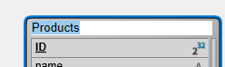
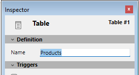

テーブルは全ての4D データベースの基盤です。それぞれのテーブルは、同じフィールドとプロパティの集合を共有するレコードの集合を定義します。ストラクチャーエディターでは、テーブルはグラフィカルなオブジェクトとして表示され、作成、名称変更、削除が可能で、またその属性を個別に設定することが可能です。

4D が提供するツールを使用して、以下のようなことを行えます:

- テーブルを定義し、その主キーやリレーションを管理する
- トリガ、表示状態、複製などのテーブルレベルのプロパティを設定し編集する
- 命名規則を管理しテーブルをフォルダに管理しメンテナンスを容易にする

## テーブルの作成

直接ストラクチャウィンドウで、あるいはダイアログボックス経由で、テーブルを作成することができます。直接の作成は素早く行えますが、ダイアログボックスを 使用した作成ではテーブルの特定のパラメターを設定したり、必要であれば作成をキャンセルすることができます。またコピー/ペーストでテーブルを作成する こともできます。

- 新規テーブルを直接作成するには:

1. ストラクチャーエディターウィンドウの空のエリアで右クリックをし、コンテキストメニューから**テーブル追加...** を選択します。  
   **または**
   [ストラクチャーエディターツールバー](./structure-editor.md#ツールバー) のオブジェクト追加メニューから、テーブルを選択します。

4Dは直接ストラクチャーエディター内にテーブルを作成します。その後、名前を変更したりフィールドを追加したりできます。

:::note

テーブルを特定のフォルダーに入れたい場合、エクスプローラーのホームページを使用します。

:::

- “新規テーブル”ダイアログボックスを使用してテーブルを作成するには:

1. **ファイル**メニューの **新規 > テーブル...** コマンドを選択します (または4Dツールバーの**新規**ボタンをクリックします)。  
   **または**
   エクスプローラーのテーブルページで、 **\[+]** ボタンをクリックします。

"新規テーブル"ダイアログボックスが表示されます。 4D は最初のテーブルに `Table_1` と名前をつけ、それ以降は順番に番号を振っていきます:

2. (任意) 作成する[テーブルの名称](../Concepts/identifiers.md#テーブルとフィールド) を変更します。
3. (任意) 新しいテーブルを配置するフォルダーを選択します。  
   デフォルトでテーブルはフォルダー階層のトップレベルに配置されます。フォルダーはエクスプローラーのホームページ内で管理されます。
4. **OK** をクリックします。  
   4D は新しいテーブルイメージを作成します。それがストラクチャーエディターウィンドウ内で選択されます。

- コピー/ペーストでテーブルを作成するには:

1. 複製するテーブルを選択し、コピーします。
2. ストラクチャーウィンドウ内でテーブルを貼り付けします。

テーブルはすべてのフィールドとプロパティとともにペーストされます。

## テーブルの名称変更

テーブルはいつでも名称変更できます。古いテーブル名がメソッド中で使用されていた場合、4D は自動でそれを新しい名称で置き換えます(メソッドがエディタで開かれていてはいけません)。メソッドが開かれている場合、手作業で変更を行う必要があります。データベース内でテーブル名はユ ニークでなければなりません。

テーブル名の変更はストラクチャーエディター、エクスプローラー、またはインスペクターパレットを使用して直接行うことができます。

(ストラクチャーエディターまたはエクスプローラーのテーブルページを使用して)テーブル名を直接変更するには、テーブル名を2回クリックし(テーブルが既に選択されている場合は1回クリック)、編集モードにスイッチします:

新しい名称を入力し、テーブルの外側をクリックします。

ストラクチャーエディターのインスペクターパレットを使用して名称変更するには、テーブル名をダブルクリック(またはテーブルイメージ上で右クリックをし、コンテキストメニューから\*\*テーブルプロパティ...\*\*を選択)し、"名称"エリアに新しい名前を入力します。

4D はインスペクターパレット内に選択されたテーブルの名前とプロパティを表示します。このパレットにはテーブル番号も表示されます。インスペクターペレット が既に開かれていて、他のテーブルや他のオブジェクトのプロパティを表示している場合には、名称変更したいテーブルのテーブルイメージを選択すると、パ レットにそのテーブルのプロパティが表示されます。

## テーブルの削除

テーブルはデータベースから削除することができます。 4D では二つの方法でテーブルを削除できます: **恒久的削除** (テーブルおよびそのデータが実際にデータベースから取り除かれる削除) と**非恒久的削除** (テーブルが単にエクスプローラーのゴミ箱に置かれあとで元に戻すことができる削除) の二つです。

:::info

テーブルの削除は[4D のSQL エンジン](https://doc.4d.com/4Dv21/4D/21/4D-SQL-Reference.100-7649299.ja.html) を使用して行うこともできます。

:::

### 恒久的削除

ストラクチャーエディターで一つまたは複数のテーブルを恒久的に削除するには:

削除するテーブルを選択し、**編集**メニューから**クリア**を選択するか、テーブルのコンテキストメニューから**削除**を選択します。

警告ダイアログが表示され、処理を続行するか確認されます。 **OK** をクリックすると、4D は以下の処理を行います:

- テーブルは恒久的にストラクチャーから削除されます。またデータファイルから、そのテーブル関連するデータが恒久的に削除されます。
- テーブルのトリガーメソッドが削除されます。
- テーブルに関連づけられていたテーブルフォームとリストフォームはプロジェクトフォームとなり、エクスプローラーのゴミ箱に移動されます。

### 非恒久的削除

テーブルの非恒久的削除は、プロジェクトのゴミ箱(エクスプローラーからアクセス可能)に、削除するテーブルを移動することで行われます。これはWindows やmacOS に実装されたファイル削除のメカニズムと同様のものです。

これを行うとテーブルは4Dのエディターに表示されず、その内容にアクセスすることもできなくなりますが、ゴミ箱を空にしない限り元に戻すことが可能です。

ストラクチャーエディターから一つまたは複数のテーブルをゴミ箱に移動するには、テーブルのコンテキストメニューから**ゴミ箱に移動**コマンドを選択するか、削除するテーブルを選択し、**Delete** または**Backspace** キーを押します。確認ダイアログが表示されます。 **OK** をクリックすると、テーブルはゴミ箱に移動されます。ゴミ箱を空にしない限りエクスプローラーのゴミ箱ページからいつでも元に戻すことができます。

### 削除されたテーブルの番号

テーブルが削除されても、データベースの安定性を損ねることを避けるために、データベース中の他のテーブルの番号は変更されません。そのため例えば3 つのテーブルがあるデータベースにおいて、それらのテーブル番号が2, 4 および 5であるといったことが起こり得ます。

恒久的に削除されたテーブルのテーブル番号は、新しくテーブルが作成されるときに再利用される点に留意してください。

## テーブルプロパティ

**インスペクターパレット**を使用してテーブルのプロパティを設定できます。また特定のプロパティについてはテーブルのコンテキストメニューからも設定できます。

### Triggers

[trigger](./triggers) はテーブルに関連する特定のイベントが発生した際に自動で実行されるメソッドです。トリガーイベントは**インスペクターパレット** またはテーブルに割り当てられたコンテキストメニューを使用(テーブルのタイトルエリアを右クリック)して設定できます。[有効にしたいトリガー](./triggers#トリガーのアクティブ化と作成) のイベントにチェックします。

テーブルのトリガーには、ストラクチャーエディターのテーブルインスペクターパレットで**編集...**ボタンをクリックするか、テーブルのコンテキストメニューから**メソッド編集...**サブメニューを選択します。エクスプローラーの**メソッドページ**を使用してトリガーを作成および表示ができます。

**ストラクチャーエディター**の[情報バー](./structure-editor.md#情報バー) には有効にされているトリガーがテーブルごとに表示されます。

### 属性

アピアランスや一般的な振る舞いを指定するために、テーブルごとに異なる属性を設定できます。

#### 非表示

このオプションを使用して、アプリケーションモードおよびプラグインからテーブルを見えなくできます。このオプションはユーティリティテーブルや、一時的に使用しないテーブルに対して使用できます。

テーブルを非表示にすることで、アプリケーションモードのすべてのエディター上やいくつかのダイアログボックスでそのテーブルとフィールドが非表示になり、ユーザーがテーブルに対して行うことのできる処理を制限できます。またプラグインから使用することもできなくなります。

アプリケーションモードにおいて関連するエディターやダイアログボックスは以下の通りです:

- すべてのクエリーエディター
- 並び替えエディター
- [ラベルエディター](../Desktop/labels.md)
- クイックレポートエディター
- データの読み込みと書き出しダイアログボックス
- フォーミュラエディター

これらのエディターそれぞれで、ユーザーはテーブルやそのフィールドを見たり選択したりすることはできません。例えばレポートやラベルに非表示テーブルのフィールドを含めることはできません。

:::note 注記

- これらのエディターを使用する際、ユーザーは設定をディスクファイルに保存することができます (例えば作成したクエリや並び替え設定)。その設定ファイルが使用される場合、設定が作成された後に非表示にされたテーブルやフィールドは、あとの操作でも使用することが可能です。
- ユーザーはフォーミュラエディターダイアログボックスに非表示テーブルやフィールド名をタイプ入力することが可能です。
- またこの属性をそれぞれのフィールドに対して個別に設定することも可能です。

:::

非表示テーブルとフィールドはストラクチャーエディターウィンドウ内で*イタリック* で表示されます。

#### テーブルイメージのカラー

テーブルイメージごとにカラーを割り当てることができます。カラーを使用すると、大きなデータベースストラクチャーでグループを視認しやすくできます。例えば顧客や顧客にリレートするすべてのテーブルに同じカラーを設定し、在庫や在庫にリレートするすべてのテーブルに別のカラーを割り当てることができます。

:::note

個々のフィールドやリレーションにカラーを割り当てることもできます。

:::

テーブルにカラーを設定するには、テーブルを選択し、以下の方法でカラーを選択します:

- ストラクチャーエディターツールバーの**カラー**ボタン
- テーブルのコンテキストメニューの**カラー**コマンド
- **インスペクターパレット**の**カラー**オプション

**自動**オプションを使用すると、テーブルのデフォルトカラーが使用されます。

#### REST リソースとして公開

このオプションは、[テーブルがREST リクエストに対して公開されるかどうか](../REST/configuration.md#テーブルの公開) を管理します。

:::note 注記

- このオプションは、テーブルのフィールドレベルで個別に設定することもできます。
- このオプションは [ORDA のリモートデータストア機能](../ORDA/remoteDatastores.md)のコンテキストにおいて使用されます。

:::

#### レコードを完全に削除

このオプションを使用すると、[`DELETE SELECTION`](../commands/delete-selection) コマンドを使用して選択したレコードを削除する際の動作を最適化できます。

4Dはレコードのセレクションを削除する際、レコードマーカーも削除します。レコードマーカーはそのレコードに関連する情報を含む、レコードに添付されたヘッダーです。マーカーとレコード両方を削除するのは、レコードだけを削除するよりも時間がかかります。特定の場合においては、レコードマーカーを自動では削除しないほうに設定した方がよいこともあります。

[`DELETE SELECTION`](../commands/delete-selection) を使用して実行される大量のセレクションの削除を加速するために、**レコードを完全に削除** オプションの選択を解除できます。そうするとレコードマーカーは削除されなくなります。このオプションをプログラムで設定することはできません。

#### 複製を有効にする

:::info 非推奨

SQL を使用した複製と同期の機構は4D 20 R3 以降は非推奨となっています。これらはまだサポートされていますが、現在は[ORDA ベースのグローバルスタンプ機能](../ORDA/global-stamp.md) を使用することが推奨されます。この機能は4D 内において複製と同期を実装するための柔軟で堅牢なソリューションを提供します。

:::

#### ログファイルに含める

このオプションは、作成された全ての新しいテーブルと変換されたデータベースにおいては、デフォルトでチェックがされています。テーブルのデータに対して行われたオペレーションを、全て[データベースのログファイル](../Backup/log.md)(作成時)に含めたい場合にはこのオプションにチェックを入れて下さい。

このオプションは一般的に、ほとんどのテーブルにおいてチェックされるべきものです。しかしながら、最適化の観点から、例えばデータをインポートするために一時的に使用するテーブルなどではチェックを外すこともできます。

このオプションは、データベースがログファイルを使用する場合には、そのテーブルのデータがログに記録されなければならないという指示にすぎず、データベースレベルでのデータログ処理そのものを有効化するスイッチではないということに留意して下さい。

:::note 注記

- このオプションはテーブルがプライマリーキーを持っていない場合にはグレーになって選択することができません。
- 必要要件を満たしていない場合は、**ログファイルに含める** のオプションの横に警告アイコンが表示されます。このアイコンが表示されている限り、データログは有効化されていません。

:::

#### 暗号化可能

このオプションは、[データファイル暗号化が有効化された](../MSC/encrypt.md) 際に、テーブルに保存されたデータがディスク上で暗号化されるべきかどうかを管理します。

暗号化 / 復号化は時間がかかることがあるため、暗号化するテーブルを選択することで暗号化されたデータベースの操作を最適化することができます。例えば、個人データを格納しているデータのみを**暗号化可能**に設定する、とすることが可能です。

このオプションはテーブルにフラグを立てるだけであり、実際の暗号化/復号化操作を実行するわけではないことに注意してください。実際にデータファイル内で選択されたテーブルを暗号化あるいは復号化するためには、[MSC](../MSC/encrypt.md) あるいは[`Encrypt data file`](../commands/encrypt-data-file) コマンドを使用しなければなりません。

:::warning

- 既に暗号化されているデータベース内でこのオプションの値を変更した場合、データの一貫性を保つために必ず[MSC](../MSC/encrypt.md) か[`Encrypt data file`](../commands/encrypt-data-file) コマンドを使用しなければなりません。使用しない場合、編集したテーブル内にデータを保存することができません(レコードを保存しようとした場合、4D はエラーを返します)。
- データファイルの外部に保存されているデータの暗号化は、このオプションによる管理できません。

:::

### コメント

**インスペクターパレット**の**コメント**エリアにはテーブルに関する追加の情報を格納できます。このコメントはすべての開発者が利用できます。各フィールドおよびリレーションごとにコメントエリアがあります。

### SQL

- “スキーマ”メニューにはデータベースに定義されたすべてのSQL スキーマが一覧されます。このメニューを使用して、テーブルが属するスキーマを指定できます (このプロパティはSQL コマンドを使用して変更することもできます)。すべてのデータベースには最低1つの、**DEFAULT_SCHEMA** という名前のスキーマがあります。デフォルトですべてのテーブルはこのスキーマに属します。 SQL スキーマに関する詳細は*4D SQL リファレンス* の[**スキーマ** の章](https://doc.4d.com/4Dv21/4D/21/4D-SQL-engine-implementation.300-7649386.ja.html#148386) を参照してください。
- 情報エリアは、テーブル名がSQL の命名規則に沿っているかどうかを表示します (例えば4D と異なり、SQL ではフィールド名にスペースを含めることはできません)。

### プライマリーキー(主キー)

プライマリーキー(主キー)は、テーブル内のレコードを個別に識別するために使用されるフィールドを指定します。[データログ機能](../Backup/log.md) を使用するためにはプライマリーキーを設定しなければなりません。

ストラクチャーエディターのコンテキストメニューまたは[プライマリーキーマネージャー](#プライマリーキー-主キー-マネージャー) を使用して、直接プライマリーキーを作成/編集/削除することができます。

> **注:** プライマリーキーは、SQL ランゲージにて**PRIMARY KEY** 節のあとカラムのリストを記述することでも作成することができます。

#### プライマリーキーフィールドの使用ルール

プライマリーキーフィールドは、データの整合性を保証するために常に細心の注意で管理すべきものです。具体的には、プライマリーキーフィールドは以下のルールを遵守する必要があります:

- 空であってはいけません。
- 固有(重複不可)でなければなりません。
- 一度作成されたら、原則として変更してはなりません。以下のような場合には絶対変更してなりません:
  - [グローバルスタンプ機能](../ORDA/global-stamp.md) が有効化されている
  - [REST (あるいはそれに似た)機能](../REST/gettingStarted.md) が有効化されている
  - データベースが([ログファイル](../Backup/log.md) を使用したバックアップあるいは論理ミラーを使用して)定期的に同期されている。

プライマリーキーフィールドを変更することは、たとえ4D が特殊な場合に対して許可しているとしても、変更しないことが強く推奨されます。  
どうしてもプライマリーキーフィールドを変更しなくてはいけない場合(例：マイナンバーをプライマリーキーとして指定してしまい、誤った番号を入力してしまった、等)でも、変更する代わりにカレントのプライマリーキーを無効化(削除)して自動割り当てをつけた新しいフィールドを追加してプライマリーキーフィールドとして使用する方が望ましいです。

プライマリーキーフィールドは、倍長整数型がUUIDフォーマット(文字型)が選べます。多くの場合、自動UUIDオプションを有効化したUUIDフォーマットの方が推奨されます。倍長整数型の方が使用するディスク容量が小さいのですが、UUID には他の多くの利点があります。例えば、独立したデータベースの統合が容易であったり、データの読み込み/書き出し、精巧なミラー/複製戦略の実装、あるいは外部システムとの同期、などにおいて有利です。

#### プライマリーキーの設定

ストラクチャーエディターからプライマリーキーを作成するためには、以下の手順に従って下さい:

1. テーブルのプライマリーキーを構成するフィールド(複数も可)を選択します。
2. 右クリックでコンテキストメニューを表示し、**主キーを作成**を選択します(このコマンドは主キーとして使用可能な型のフィールドに対してのみ表示されます)。

一つのテーブルにつき二つ以上のプライマリーキーを作成することはできません。プライマリーキーが既にテーブルにおいて指定されている場合、既存のプライマリーキーは無効化されるという旨の警告ダイアログボックスが表示されます。

プライマリーキーは直ちに作成されます。プライマリーキーに含まれるフィールドはエディター上では下線が引かれ、インスペクターのSQL の詳細には**PRIMARY KEY** のキーワードが入ります。

既にレコードが存在するテーブルに主キーを作成した場合(既存フィールドを使用、あるいは新規に追加した場合)、4D は存在している全ての値の適合性をチェックするか、あるいは自動的にアップデート操作を実行します:

- 主キーに属しているフィールド内では重複している値を持つ事はできません。テーブルのレコード内に重複している値が存在していた場合、この値の為に主キーを作成する事ができない旨を示す警告ダイアログボックスが表示されます。
- 重複した値が空の値、またはヌル値(追加されたフィールド)だった場合、それに対応する自動生成オプションをチェックする事ができます(文字フィールドでの自動UUID、または倍長整数フィールドでの自動インクリメント)。  
  この場合、4D はテーブルの全てのレコードを検査し計算された値をそれぞれの主キーに自動的に割り当てます。ただし処理はシーケンシャルであり、レコードの数が大量であった場合、この処理に長い時間を要することがあるという点に注意して下さい。

> **注:** プライマリーキーに所属するカラムは、ヌル値を受け付けません。

#### プライマリーキーの削除

テーブルからプライマリーキーを削除するためには、以下の手順に従って下さい:

1. プライマリーキーを含むテーブルを右クリックしてコンテキストメニューを表示し、**主キーを削除**を選択します。確認ダイアログが表示されます。プライマリーキーを削除するためには**OK**をクリックします。

#### デフォルトのプライマリーキーフィールド

新規に作成されるテーブルには全てデフォルトでプライマリーキーが含まれています。このフィールドは、デフォルトで名前が **"ID"** の倍長整数型のフィールドであり、特に以下の属性を持ちます:

- 重複不可
- ヌル値の入力を拒否
- 自動インクリメント
- 自動インデックス

このフィールドはそのまま使用することもできますし、必要に応じて名前やプロパティを変更する事もできます (例えば UUID フィールドを使用する等)。また、他のフィールドをプライマリーキーとして使用する場合はプライマリーキーを削除することはできます。ただし、全ての 4D テーブルに最低一つずつプライマリーキーを用意しておくことが強く推奨されます。

:::note

[環境設定のストラクチャーページ](../Preferences/structure.md) にて、プライマリーキーのデフォルトの名前と型を変更することができます。

:::

:::info

デフォルトのプライマリーキーは、SQL **CREATE TABLE** コマンドを使用して作成されたテーブルやデータベースにインポートされたテーブルには追加されません。

:::

## プライマリーキー(主キー)マネージャー

**プライマリーキー管理** (プライマリーキーマネージャー)というアシスタントウィンドウは、特にログを使用しているデータベースにおいて、プライマリーキーがないテーブルに起因するエラーの解消を手助けするためのものです:

このアシスタントには以下の様な機能があります:

- データベースのそれぞれのテーブルと 4D のデータログのメカニズムとの競合性を検証します。
- データログのメカニズム合致しないテーブルに対してそれぞれに解決方法を提示します。具体的にはプライマリーキーの作成です。

### アシスタントを表示

**プライマリーキー管理** ウィンドウを表示する方法は二通りあります:

- **プライマリーキーエラーウィンドウ** から表示: **アシスタントを起動**ボタンをクリックしてアシスタントウィンドウを表示します。

**注:** プライマリーキー管理はデザインモードで表示されます。データベースがアプリケーションモードで開かれた場合はアシスタントは直ちには表示されず、デザインモードへと切り替える必要があります。

- **ストラクチャーエディター**から: ウィンドウの[ツールバー](./structure-editor.md#ツールバー) 内の新しいボタン をクリックするとアシスタントを表示できます。

### アシスタントの使用

**プライマリーキー管理**ウィンドウではデータベース内の全てのテーブルに関しての情報が行となって表示されます:

アシスタントはごみ箱に入っているテーブルは検知しません。

それぞれの行の先頭にあるアイコンはテーブルの状態をユーザーに知らせます:

| アイコン                                   | ステータス                   | 説明                                                                                                                             |
| -------------------------------------- | ----------------------- | ------------------------------------------------------------------------------------------------------------------------------ |
|  | OK                      | テーブルには有効なプライマリーキーがあります。                                                                                                        |
|  | プライマリーキーなし、使用可能なフィールド有り | テーブルにはプライマリーキーがないものの、プライマリーキーとして使用できるフィールドが少なくとも一つは含まれています。                                                                    |
|  | プライマリーキーも使用可能なフィールドもなし  | テーブルにはプライマリーキーも、プライマリーキーとして使用できるフィールドもありません(プライマリーキーフィールドを作成する必要があります)。                                     |
|  | 警告                      | テーブルにはプライマリーキーがありませんが、データのログを取りません("ログファイルに含める"のオプションのチェックが外されています)。この状態のテーブルは、警告アイコンをクリックすることによって非表示にできます。 |

データログを残すテーブルでプライマリーキーがないものに関して、アシスタントはそれぞれに実行すべきアクションを表示します。以下の選択肢から選ぶことができます:

- **無視:** テーブルに何も変更を加えません。エラーは修正されず、テーブルの状態は変更されません。後でエラーを修正したい場合、またはアシスタントを使用せずにエラーを修正したい場合などにはこのオプションを選択して下さい。このオプションは特に、複数のテーブルをもとにプライマリーキーを作成したい場合に必要です。

- **既存のフィールドを使用**(プライマリーキーとして使用可能なフィールドが少なくとも一つはあるテーブルにおいてのみ表示): テーブルのフィールドのどれかをプライマリーキーとして指定します。このオプションを選択すると、アシスタントはデフォルトでプライマリーキーとして最適なフィールドを選択して提示します。他のフィールドを使用したい場合、またはアシスタントが適切なフィールドを識別するのに失敗した場合(この場合アシスタントは *選択可能なフィールド* を表示します) などは、行の中の二つ目のメニューをクリックして選択可能なフィールドのリストを表示して下さい。

- **新規フィールドを作成:** テーブル内に新しいプライマリーキーを作成します。このフィールドは[新規テーブルが作成されたときのもの](#デフォルトのプライマリーキーフィールド) と同じ属性を持ちます。デフォルトでは、アシスタントは "ID" という名前の倍長整数型のフィールドが提示されます。このデフォルトのプライマリーキーの名前と型は[環境設定](../Preferences/structure.md#プライマリーキー)から変更することができます。プライマリーキー管理ウィンドウ内で直接テーブルの名前/型を変更することもできます。

- **このテーブルはログに含めない:** このテーブルに関しては[**ログファイルに含める**](#ログファイルに含める) のチェックを外します。一時的なテーブルなどの場合にこのオプションを選択することができます。ダイアログボックスを確定させると、"警告"の状態がテーブルへと適用されできます。

設定が完了したら**適用...** をクリックして変更をデータベースに適用するか、データベースを変更せずに閉じる場合には**閉じる**をクリックして下さい。**適用...** をクリックすると、実行されるオペレーションの一覧がダイアログボックスに表示され、適用かキャンセルがクリックできます。

既存のフィールドをプライマリーキーとして使用した場合、4D はそれぞれのテーブルに関して、既存のデータがそのフィールドの型の固有性やヌル値の設定とあてはまるかどうかを検証します。もし、例えばフィールドが複製値やヌル値を含んでいた場合、エラーが生成されます。データログを有効にするためにはこれらのエラーを探して削除する必要があります。

:::note

プライマリーキーに関するエラーの修正を容易にするために、プライマリーキーの値は[MSCの **アクティビティ解析ページ**](../MSC/analysis.md) の中に表示されています。

:::
