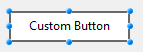
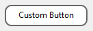

## 交互に使用する背景色

奇数番の行/列に使用するための異なる背景色を設定することができます。リストボックス列では、デフォルトで *自動* が選択されています。また、リストボックス列は、リストボックスレベルで設定されている "交互に使用する背景色" も使用します。

このプロパティは[`OBJECT SET RGB COLORS`](../commands/object-set-rgb-colors) コマンドを使用しても設定することができます。

#### JSON 文法

| 名称            | データタイプ | とりうる値                                                      |
| ------------- | ------ | ---------------------------------------------------------- |
| alternateFill | string | 任意の CSS値; "transparent"; "automatic"; "automaticAlternate" |

#### 対象オブジェクト

[リストボックス](listbox_overview.md) - [リストボックスカラム](listbox-column.md)

#### コマンド

[`OBJECT GET RGB COLORS`](../commands/object-get-rgb-colors) - [`OBJECT SET RGB COLORS`](../commands/object-set-rgb-colors)

---

## 背景色/塗りカラー

オブジェクトの背景色/塗りカラーを設定します。一部の標準のオブジェクト(`fill` JSON プロパティを使用) あるいは["custom style" オブジェクト](#custom-button-custom-check-box-or-custom-radio-button)(`borderFillColor` JSON プロパティを使用) に対して定義することが可能です。

:::note

**塗りカラー** プロパティは[リストボックス](listbox_overview.md)、[リストボックスカラム](listbox-column.md) および[List Box Footer](listbox-header-footer.md#フッター) オブジェクトでは**背景色** という名前になっています。

:::

### 標準のオブジェクト

リストボックス列の場合は、デフォルトで *自動* が選択されています。また、リストボックス列は、リストボックスレベルで設定されている "交互に使用する背景色" も使用します。

#### JSON 文法

| 名称   | データタイプ | とりうる値                                |
| ---- | ------ | ------------------------------------ |
| fill | string | 任意の css値; "transparent"; "automatic" |

#### 対象オブジェクト

[階層リスト](list_overview.md) - [リストボックス](listbox_overview.md) - [リストボックスカラム](listbox-column.md) - [リストボックスフッター](listbox-header-footer.md#フッター) - [楕円](shapes_overview.md#楕円) - [四角](shapes_overview.md#四角) - [テキストエリア](text.md)

#### コマンド

[`LISTBOX Get row color`](../commands/listbox-get-row-color) - [`LISTBOX SET ROW COLOR`](../commands/listbox-set-row-color) - [`OBJECT GET RGB COLORS`](../commands/object-get-rgb-colors) - [`OBJECT SET RGB COLORS`](../commands/object-set-rgb-colors)

### カスタムボタン、カスタムチェックボックス、あるいはカスタムのラジオボタン

このプロパティを使用することで、[カスタムボタン](./button_overview.md#カスタム) 、[カスタムのチェックボックス](./checkbox_overview.md#カスタム) 、あるいは[カスタムのラジオボタン](./radio_overview.md#カスタム) に対して塗りカラー属性を割り当てることができます。さらに、[カスタムボタン](./button_overview.md#カスタム) の場合には、["カスタム" 境界線スタイル](#border-line-style) になっている必要があります。その他のコンテキストにおいては、このプロパティは無視されます。

#### JSON 文法

| 名称              | データタイプ | とりうる値                                |
| --------------- | ------ | ------------------------------------ |
| borderFillColor | string | 任意の css値; "transparent"; "automatic" |

#### 対象オブジェクト

[カスタムボタン](button_overview.md#カスタム)(["カスタム" の境界線スタイル](#border-line-style) のもの) - [カスタムチェックボックス](checkbox_overview.md#カスタム) - [カスタムラジオボタン](radio_overview.md#カスタム)

#### コマンド

[`OBJECT GET RGB COLORS`](../commands/object-get-rgb-colors) - [`OBJECT SET RGB COLORS`](../commands/object-set-rgb-colors)

#### 参照

[透過](#透過)

---

## 背景色式 {#background-color-expression}

`セレクションとコレクション型リストボックス`

リストボックスの各行にカスタムの背景色を指定するための式または変数 (配列変数は使用不可)。式または変数は表示行ごとに評価され、RGB値を返さなくてはなりません。詳細については、[`OBJECT SET RGB COLORS`](../commands/object-set-rgb-colors) コマンドの詳細を参照してください。

また、このプロパティは [`LISTBOX SET PROPERTY`](../commands/listbox-set-property) コマンドに `lk background color expression` 定数を指定して設定することもできます。

> コレクション/エンティティセレクション型リストボックスでは、このプロパティは [メタ情報式](properties_Text.md#メタ情報式) を使用しても設定することができます。

#### JSON 文法

| 名称            | データタイプ | とりうる値       |
| ------------- | ------ | ----------- |
| rowFillSource | string | RGBカラー値を返す式 |

#### 対象オブジェクト

[リストボックス](listbox_overview.md) - [リストボックスカラム](listbox-column.md)

#### コマンド

[`LISTBOX Get property`](../commands/listbox-get-property) - [`LISTBOX SET PROPERTY`](../commands/listbox-set-property)

---

## 境界線カラー{#border-color}

境界線のカラーを定義することができます。このプロパティの効果は、適用されるオブジェクトのタイプによって若干異なります。

- **テキストプロパティを持つオブジェクト**: [ボタン](./button_overview.md) ("カスタム" を除く全てのスタイル、詳細は以下参照)、[階層リスト](list_overview.md)、[入力](input_overview.md)、[リストボックス](listbox_overview.md)、[進捗インジケーター](./progressIndicator.md)、[ルーラー](./ruler.md), and [text areas](text.md)。  
  デフォルトで、これらのオブジェクトの境界線カラーは自動的に[**フォントカラー**](./properties_Text.md#フォントカラー) プロパティと同じに設定されています。このデフォルトの設定はプロパティリストの**Same as font** オプションに対応しています(`borderColor` プロパティはJSON では未定義です)。  
  これらの二つのプロパティはオブジェクトの"境界線カラー" プロパティ([**境界線スタイル**](#border-line-style) プロパティが**実線** (JSON プロパティでは`solid`) あるいは **点線**のときのみ利用可能) にカラー値を設定することで分離させることができます。

- **テキストプロパティを持たないオブジェクト**: [4D View Pro エリア](viewProArea_overview.md)、[4D Write Pro エリア](writeProArea_overview.md)、[ボタングリッド](buttonGrid_overview.md)、[ピクチャーボタン](pictureButton_overview.md)、[ピクチャーポップアップメニュー](picturePopupMenu_overview.md)、[プラグインエリア](pluginArea_overview.md)、[サブフォーム](subform_overview.md)、[スピナー](spinner.md)、[スプリッター](splitters.md)、[ステッパー](stepper.md)、[Web エリア](webArea_overview.md)。  
  境界線カラープロパティは境界線のカラーを設定します。デフォルトのカラー値は"自動"で、これは境界線がOS によって設定されている自動カラーで表示されることを意味します。

- **カスタムスタイルのボタン**: ["カスタム" 境界線スタイル](#border-line-style)をもった[カスタムボタン](./button_overview.md#カスタム)、[カスタムチェックボックス](./checkbox_overview.md#カスタム)、および[カスタムラジオボタン](./radio_overview.md#カスタム)。  
  この場合、境界線カラープロパティーは*内側の* 境界線カラーを定義し、これはオブジェクト自身の属性であり、装飾プロパティではありません。内側の境界線は[幅](#border-width) を持つこともできます(幅が0 より大きい場合にのみ表示されます)。

#### JSON 文法

| 名称          | データタイプ | とりうる値                                |
| ----------- | ------ | ------------------------------------ |
| borderColor | string | 任意の css値; "transparent"; "automatic" |

#### 対象オブジェクト

[4D View Pro エリア](viewProArea_overview.md) -
[4D Write Pro エリア](writeProArea_overview.md) -
[ボタン](button_overview.md) -
[ボタングリッド](buttonGrid_overview.md) -
[チェックボックス("カスタム"スタイル)](checkbox_overview.md#custom) -
[階層リスト](list_overview.md) -
[入力](input_overview.md) -
[リストボックス](listbox_overview.md) -
[ピクチャーボタン](pictureButton_overview.md) -
[ピクチャーポップアップメニュー](picturePopupMenu_overview.md) -
[プラグインエリア](pluginArea_overview.md) -
[進捗インジケーター](progressIndicator.md) -
[ラジオボタン("カスタム"スタイル)](radio_overview.md#custom) -
[ルーラー](ruler.md) -
[テキストエリア](text.md) -
[スピナー](spinner.md) -
[Splitter](splitters.md) -
[ステッパー](stepper.md) -
[サブフォーム](subform_overview.md) -
[Web エリア](webArea_overview.md)

#### コマンド

[`OBJECT GET RGB COLORS`](../commands/object-get-rgb-colors) - [`OBJECT SET RGB COLORS`](../commands/object-set-rgb-colors)

#### 参照

[線カラー](#線カラー) (図形用)

## 境界線スタイル{#border-line-style}

オブジェクトの境界線のスタイルを設定することができます。以下の選択肢が利用可能です(オブジェクトによっては全ての選択肢が利用可能ではないこともあります):

| スタイル      | オブジェクト(\*)                             | 説明                                                                                                                                                                                                                                                                                                                                                                                                                                                                   |
| --------- | --------------------------------------------------------- | -------------------------------------------------------------------------------------------------------------------------------------------------------------------------------------------------------------------------------------------------------------------------------------------------------------------------------------------------------------------------------------------------------------------------------------------------------------------- |
| なし        | all                                                       | オブジェクトは境界線なしで表示されます。                                                                                                                                                                                                                                                                                                                                                                                                                                                 |
| 標準        | all                                                       | オブジェクトは連続した1pt の幅の境界線で表示されます。 ("solid" json 値)                                                                                                                                                                                                                                                                                                                                                                                                    |
| ドット       | all                                                       | オブジェクトは点線の1pt の幅の境界線で表示されます。                                                                                                                                                                                                                                                                                                                                                                                                                                         |
| 浮き上がり     | all                                                       | オブジェクトは3D エフェクトの境界線で表示されます。                                                                                                                                                                                                                                                                                                                                                                                                                                          |
| くぼみ       | all                                                       | オブジェクトは、くぼみ3D エフェクトの境界線で表示されます。                                                                                                                                                                                                                                                                                                                                                                                                                                      |
| 二重        | all                                                       | オブジェクトは連続した1pt の幅の二重線の境界線で表示されます。二重線は1ピクセル間の隙間で表示されます。                                                                                                                                                                                                                                                                                                                                                                                                               |
| システム      | [ボタン](button_overview.md)および [テキストエリア](text.md) を *除く* 全て | オブジェクトはOS のグラフィック仕様に基づいた境界線で表示されます。                                                                                                                                                                                                                                                                                                                                                                                                                                  |
| システムの角の丸み | [入力](input_overview.md)                                   | macOS では、オブジェクトはネイティブの"Liquid Glass" システム境界線エフェクトで表示されます(Liquid Glass についての情報については[こちらの4D blog 記事](https://blog.4d.com/the-new-macos-tahoe-design-comes-to-your-4d-applications/))。これにはシステム定義の内側の境界線、角の半径、グレーの境界線カラー、そして内側のパディングが含まれます。[スクロールバープロパティ](./properties_Appearance.md#縦スクロールバー) が有効化されている複数行の入力オブジェクト内においてはアピアランスは使用されないという点に注意してください(この場合には"システム"が使用されます)。<br/> Windows においては、このスタイルはランタイムでは"システム" に似たスタイルで表示されます。 |
| カスタム      | [カスタムボタン](./button_overview.md#カスタム)                      | 内側の境界線デザインを有効化し、これには以下の追加のプロパティのセットが含まれます: [塗りカラー](#背景色-塗りカラー)、[境界線カラー](#border-color)、[境界線幅](#border-width)、および[角の半径](#角の半径)。 <br/>                                                                                                                                                                                                                                                                  |

(\*) この"all" または"全て" とは、以下の"サポートされる全てのオブジェクト" を意味します。

:::tip 関連したblog 記事

- [Customize Buttons, Radio Buttons, and Check Boxes with Background and Border Properties](https://blog.4d.com/customize-buttons-radio-buttons-and-check-boxes-with-background-and-border-properties).
- [Give Your Form Objects the Border Color They Deserve](https://blog.4d.com/give-your-form-objects-the-border-color-they-deserve)
- [Choose the Right Native Input Style for Your Interface on macOS](https://blog.4d.com/choose-the-right-native-input-style-for-your-interface-on-macos)

:::

#### JSON 文法

| 名称          | データタイプ | とりうる値                                                                                        |
| ----------- | ------ | -------------------------------------------------------------------------------------------- |
| borderStyle | text   | "custom"、 "dotted"、 "double"、 "none"、 "raised"、 "solid"、 "sunken"、 "system"、 "systemRounded" |

#### 対象オブジェクト

[4D View Pro エリア](viewProArea_overview.md) -
[4D Write Pro エリア](writeProArea_overview.md) -
[ボタン](button_overview.md) -
[ボタングリッド](buttonGrid_overview.md) -
[階層リスト](list_overview.md) -
[入力](input_overview.md) -
[リストボックス](listbox_overview.md) -
[ピクチャーボタン](pictureButton_overview.md) -
[ピクチャーポップアップメニュー](picturePopupMenu_overview.md) -
[プラグインエリア](pluginArea_overview.md) -
[進捗インジケーター](progressIndicator.md) -
[ルーラー](ruler.md) -
[スピナー](spinner.md) -
[ステッパー](stepper.md) -
[サブフォーム](subform_overview.md) -
[テキストエリア](text.md) -
[Web エリア](webArea_overview.md)

#### コマンド

[`OBJECT Get border style`](../commands/object-get-border-style) - [`OBJECT SET BORDER STYLE`](../commands/object-set-border-style)

#### 参照

[点線タイプ](#dotted-line-type) (図形)

---

## 境界線幅{#border-width}

以下のオブジェクトに対して、内側の境界線の幅を定義します:

- ["カスタム" 境界線スタイル](#境界線スタイル) を持った[カスタムボタン](./button_overview.md#カスタム)
- [カスタムチェックボックス](./checkbox_overview.md#カスタム)
- [カスタムラジオボタン](./radio_overview.md#カスタム)

その他のコンテキストにおいては、このプロパティは無視されます。

値はピクセル単位で指定しなければなりません。

#### JSON 文法

| 名称          | データタイプ | とりうる値                                |
| ----------- | ------ | ------------------------------------ |
| borderWidth | number | 整数値(ピクセル)。最小値 = 0 |

#### 対象オブジェクト

(["カスタム" 境界線スタイル](#border-line-style)を持った)[ボタン("カスタム"スタイル)](./button_overview.md#カスタム) - [チェックボックス("カスタムスタイル")](checkbox_overview.md#カスタム) - [ラジオボタン("カスタム" スタイル)](radio_overview.md#カスタム)

---

## 角の半径

<details><summary>履歴</summary>

| リリース  | 内容                                |
| ----- | --------------------------------- |
| 21 R5 | カスタムスタイルのボタン、ラジオボタン、チェックボックスのサポート |
| 19 R7 | テキストと入力オブジェクトをサポート                |

</details>

フォームオブジェクトの角の丸みをピクセル単位で指定します。デフォルトでは、角の半径は 0ピクセルとなっています。このプロパティを変更することによって独自の形の角の丸いフォームオブジェクトを描画することができます:


最小値は 0 で、この場合には標準の (角の丸くない) フォームオブジェクトが描画されます。最大値は四角のサイズに応じて変化し、動的に計算されます (ただし四角の短辺の半分を超えることはできません)。

[テキストエリア](./text.md) および[入力](./input_overview.md) では以下のように振る舞います:

- 角の半径プロパティは、[境界線スタイル](#border-line-style)が "なし"、"標準"、"ドット" の場合にのみ利用可能です
- 角の丸みはフォームオブジェクトの**外側**に描画されます (つまり、オブジェクトはより大きく表示されますが、[幅](properties_CoordinatesAndSizing.md#幅) と [高さ](properties_CoordinatesAndSizing.md#高さ) プロパティは変更されません)。


[カスタムボタン](./button_overview.md#カスタム) (["カスタム" 境界線スタイル](#border-line-style)を使用)、 [カスタムチェックボックス](checkbox_overview.md#カスタム) および[カスタムラジオボタン](radio_overview.md#カスタム) においては、角の丸みはオブジェクトのエリアの**内側**に描画されます。

  


#### JSON 文法

| 名称           | データタイプ  | とりうる値                  |
| ------------ | ------- | ---------------------- |
| borderRadius | integer | 最小値: 0 |

#### 対象オブジェクト

(["カスタム"境界線スタイル](#border-line-style)を持った)[ボタン("カスタム"スタイル)](./button_overview.md#カスタム) - [チェックボックス("カスタム" スタイル)](checkbox_overview.md#カスタム) - [入力](input_overview.md) - [四角形](shapes_overview.md#四角形) - [テキストエリア](text.md) - [ラジオボタン("カスタム" スタイル)](radio_overview.md#カスタム)

#### コマンド

[OBJECT GET CORNER RADIUS](../commands/object-get-corner-radius) - [OBJECT SET CORNER RADIUS](../commands/object-set-corner-radius)

---

## 点線タイプ {#dotted-line-type}

点線のタイプを、点と白のパターンにより指定します。

#### JSON 文法

| 名称              | データタイプ     | とりうる値                                                                                                                                      |
| --------------- | ---------- | ------------------------------------------------------------------------------------------------------------------------------------------ |
| strokeDashArray | 数値配列または文字列 | 例:  例:  6個の点と1個の空白のパターンは "6 1" または \[6,1\] によって表します。 |

#### 対象オブジェクト

[四角](shapes_overview.md#四角) - [楕円](shapes_overview.md#楕円) - [線](shapes_overview.md#線)

---

## 追加の空白の行を非表示

リストボックスオブジェクト下部に追加される余分な空白行の表示を管理します。デフォルトで、4D は空のエリアを埋めるためにこのような行を追加します:


このオプションをチェックすると、これらの空白行を除去することができます。リストボックスオブジェクトの下部は空のままになります:


#### JSON 文法

| 名称                 | データタイプ  | とりうる値       |
| ------------------ | ------- | ----------- |
| hideExtraBlankRows | boolean | true, false |

#### 対象オブジェクト

[リストボックス](listbox_overview.md)

#### コマンド

[`LISTBOX Get property`](../commands/listbox-get-property) - [`LISTBOX SET PROPERTY`](../commands/listbox-set-property)

---

## 線カラー

オブジェクトの線の色を指定します。カラーは次の方法で指定できます:

- カラーネーム - 例: "red"
- 16進数値 - 例: "#ff0000"
- RGB値 - 例: "rgb(255,0,0)"

このプロパティは[`OBJECT SET RGB COLORS`](../commands/object-set-rgb-colors) コマンドを使用しても設定することができます。

#### JSON 文法

| 名称     | データタイプ | とりうる値                                |
| ------ | ------ | ------------------------------------ |
| stroke | string | 任意の css値; "transparent"; "automatic" |

:::note

このプロパティはテキストプロパティを持つオブジェクトでも利用可能で、その場合には[フォントカラー](properties_Text.md#フォントカラー) とオブジェクトの線の両方を指定します(ただし[境界線カラー](#border-color) プロパティを使用していた場合を除く)。

:::

#### 対象オブジェクト

[線](shapes_overview.md#線) - [楕円](shapes_overview.md#楕円) - [四角](shapes_overview.md#四角)

#### コマンド

[`OBJECT GET RGB COLORS`](../commands/object-get-rgb-colors) - [`OBJECT SET RGB COLORS`](../commands/object-set-rgb-colors)

---

## 線幅

線の幅を指定します。

#### JSON 文法

| 名称          | データタイプ | とりうる値                                                      |
| ----------- | ------ | ---------------------------------------------------------- |
| strokeWidth | number | 印刷されるフォームにおける最小幅 0 から、整数値 < 20 まで |

#### 対象オブジェクト

[線](shapes_overview.md#線) - [楕円](shapes_overview.md#楕円) - [四角](shapes_overview.md#四角)

---

## 行背景色配列 {#row-background-color-array}

`配列型リストボックス`

リストボックスまたはリストボックス列の各行にカスタムの背景色を適用するのに使用する配列名です。

倍長整数型の配列の名前を入力しなければなりません。配列のそれぞれの要素はリストボックスの行 (あるいは列のセル) に対応します。 つまりこの配列は、各列に関連づけられている配列と同じサイズでなければいけません。 [`OBJECT SET RGB COLORS`](../commands/object-set-rgb-colors) コマンドの章で説明されている定数を使用することができます。もし上のレベルで定義されている背景色をそのままセルに継承したい場合には、対応する配列の要素に -255 を渡します。

たとえば、リストボックスプロパティにてグレー/ライトグレーカラーが行の交互背景色として設定されているとします。同じリストボックスに行背景色配列が指定されており、行内で負の値が一つでもあれば色をオレンジに変えます:

```4d
 <>_BgndColors{$i}:=0x00FFD0B0 // オレンジ
 <>_BgndColors{$i}:=-255 // デフォルト値
```


次に、負の値を持つセルの色を濃いオレンジで示したい場合、各列にも行背景色配列を設定します (例: `<>_BgndColor_1`, `<>_BgndColor_2` と `<>_BgndColor_3`)。これらの配列の値は、リストボックスプロパティに設定されているものや、全体用の行背景色配列よりも優先されます。

```4d
 <>_BgndColorsCol_3{2}:=0x00FF8000 // 濃いオレンジ
 <>_BgndColorsCol_2{5}:=0x00FF8000
 <>_BgndColorsCol_1{9}:=0x00FF8000
 <>_BgndColorsCol_1{16}:=0x00FF8000
```


[`LISTBOX SET ROW FONT STYLE`](../commands/listbox-set-row-font-style) および [`LISTBOX SET ROW COLOR`](../commands/listbox-set-row-color) コマンドを使用することでも同じ結果を得ることができます。コマンドを使う利点は、スタイル/カラー配列をあらかじめ列に設定する必要がないことです。 この場合、これらはコマンドによって動的に作成されます。

#### JSON 文法

| 名称            | データタイプ | とりうる値      |
| ------------- | ------ | ---------- |
| rowFillSource | string | 倍長整数型配列の名前 |

#### 対象オブジェクト

[リストボックス](listbox_overview.md) - [リストボックスカラム](listbox-column.md)

#### コマンド

[`LISTBOX Get array`](../commands/listbox-get-array) - [`LISTBOX GET ARRAYS`](../commands/listbox-get-arrays)

---

## 透過

リストボックスの背景を透明にします。このプロパティが有効になっていると、列に対して設定されている [交互に使用する背景色](#交互に使用する背景色) および [背景色](#背景色-塗りカラー) の設定は無視されます。

#### JSON 文法

| 名称   | データタイプ | とりうる値         |
| ---- | ------ | ------------- |
| fill | text   | "transparent" |

#### 対象オブジェクト

[リストボックス](listbox_overview.md)

#### コマンド

[`OBJECT GET RGB COLORS`](../commands/object-get-rgb-colors) - [`OBJECT SET RGB COLORS`](../commands/object-set-rgb-colors)

#### 参照

[背景色/塗りカラー](#背景色-塗りカラー)

