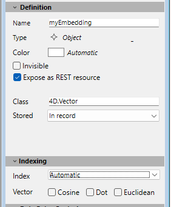
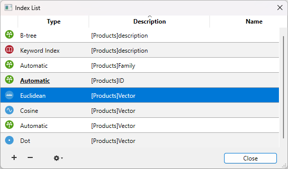

頻繁に検索や並び替えで使用されるフィールドに、インデックスを設定できます。例えば姓、会社名、製品名などの属性(フィールド)を使用してエンティティ(レコード)の検索や並び替えを行う場合、これらのフィールドにインデックスを設定することができます。またこのプロパティはテーブル間でのリレーションを確立するためにも使用されます。

フィールドにインデックスが設定されると、4D はそのフィールド用に内部的なインデックステーブルを作成します。このテーブルを使用して、4D はそのフィールドに対する素早い検索や並び替えを実行できるようになります。インデックスが設定されていないフィールドを使用して検索や並び替えを行う場合、4D はシーケンシャルにデータをロードし、レコード毎順番に評価します。インデックスを使用すれば、4D はすべてのレコードを読み込むことなく検索や並び替えを行えます。

インデックスは文字、テキスト、日付、時間、ブール、整数、倍長整数、64bit 整数、実数、ピクチャー、そしてオブジェクト型に設定できます。レコードの作成、削除、編集を行うと、4D は自動でそのインデックステーブルを更新します。既に存在するフィールドにインデックスを作成すると、4D は自動で既存のデータをインデックス化します。必要なだけフィールドにインデックスを設定できます。データベースを上位バージョンに変換する際や[データ圧縮](../MSC/compact.md) 時など、特定の処理を行った際にもインデックスが再構築されます。

各インデックステーブルの上限は次のとおりです:

- 文字、テキスト、フロートインデックスのキー: 1280億
- そのほかのインデックスタイプ (スカラーデータ) のキー: 2560億

すべてのフィールドにインデックスを設定するようなことはしないでください。インデックスはデータベースのサイズを増大させ、ディスク上のスペースを消費します。またインデックスを設定すればするほど、レコードの保存に時間を要するようになる点に留意してください。4D はレコードを受け入れるたびにインデックステーブルを更新しなければならないためです。

ストラクチャーエディター中で、インデックスが設定されたフィールドは**太字**で表示されます。

## インデックスのタイプ

4D では4種類のインデックスタイプを提供しています。そのいずれを選択するかは一般的に期待する結果と、フィールドに現れるデータに基づきます。各インデックスタイプの説明は以下の通りです:

- **標準インデックス:** これは1つのフィールドで構成されるインデックスで、標準のデータベース処理 (検索や並び替え) の速度を向上するために使用します。 4Dではさらにこのタイプのインデックスに対し、BツリーまたはクラスターBツリーを選択できます(ただしオブジェクトフィールドを除く)。
- **複合インデックス:** このインデックスは、しばしばともに検索条件に使用される2つ以上のフィールドの合成値(例えば LastName+FirstName) を格納します。
- **キーワードインデックス:** このインデックスは文字、テキストおよびピクチャーフィールドでのみ使用できます。テキスト内部の検索を容易にする目的で使用されます。またピクチャーの場合は、ピクチャーに割り当てたキーワードで検索を行うために使用できます。
- **ベクトルインデックス:** このインデックスは、[埋め込み](./field-properties.md#4dvectorクラス) を保存しているオブジェクトフィールドに対するAI ベースのクエリの速度を向上させるために設計されています。

### 標準インデックス

標準インデックスはデータベース処理の速度を向上する目的で使用されます(標準のインデックスは、キーワードインデックスや複合インデックスとは異なり、一般的なインデックスを参照します)。 4D は2つのタイプの標準インデックス、BツリーとクラスターBツリーを提供します。

- **Bツリー:** 標準のBツリータイプインデックス。この汎用目的のインデックスはほとんどのインデックスの要件を満たします。
- **クラスターBツリー:** クラスターを使用したBツリータイプのインデックス。このアーキテクチャーはインデックスに含まれるキーの量が少ない場合 (例えば同じ値がデータ中に繰り返し現れる場合) に有効です。

:::note

テキストタイプのフィールドに割り当てたBツリーインデックスは、フィールドの最初の1024文字 (最大) を格納します。そのため、このコンテキストにおいては、1024文字を超える検索をインデックスを使用して行うと失敗します。

:::

インデックスアーキテクチャーの選択を容易にするために、自動オプションを選択できます。この場合4D は自動でデータのタイプに応じインデックスのタイプを選択します。オブジェクト型のフィールドでは、選択できるオプションは**自動** オプションのみです(ただしそのフィールドに4D.Vector クラスを割り当てた場合を除く([以下参照](#ベクトルインデックス)))。この場合、**自動** オプションを使用すれば、全ての属性パスは自動的にインデックスされます。

### 複合インデックス

複合インデックスでは、レコード毎に2つ以上のフィールドの値の合成値を格納します。よく見られる例はFirstName+LastName フィールドの複合インデックスです。この場合、“Peter Smith”の検索は標準の検索(まず“Smith”を検索し次に“Peter”を検索する) よりも速くなります。

4D は検索や並び替えの際に自動で複合インデックスを利用します。例えば複合インデックス “City+ZipCode” が存在するとき、“lastname=carter & city=new york & zipcode =102@”のような検索を行うと、自動でその複合インデックスが利用されます。

ストラクチャーエディターでは、複合インデックスはインデックス作成ダイアログでのみ作成することができます。このダイアログボックスについては後述の“インデックスの作成”を参照してください。

### キーワードインデックス

キーワードインデックスは文字、テキスト、およびピクチャーフィールドに使用することができます。

- 文字およびテキストフィールドにこのタイプのインデックスを割り当てると、フィールドに格納されたテキストは単語ごとにインデックス化されます。 1文字や2文字の単語も含め、すべての単語がインデックス化されます。このタイプのインデックスはテキストフィールドのキーワードによる検索速度を劇的に向上させます。  
  文字やテキストフィールドには標準のインデックスとキーワードインデックス両方を割り当てることができます (データがレコード内に保存されている場合)。 4D はコンテキストに応じて適切なインデックスを使用します。

- ピクチャーフィールドにキーワードインデックスを使用すると、ピクチャーに割り当てられたキーワード (メタデータ) に対する検索が劇的に速くなります。警告: ピクチャーキーワードインデックスはIPTC/Keywordsタイプのメタデータを使用します。これらのタイプのメタデータは特にTIFFとJPEGでサポートされています (BMP、PNG、GIFではサポートされていません)。他のタイプのメタデータはインデックスでサポートされません。  
  ピクチャーのキーワードインデックスは、ピクチャーフィールドが保存 (レコードが作成・更新される、ピクチャーが読み込まれるなど) されるたびにIPTC/Keywordsタイプのキーワードがあれば、4Dが自動で更新します。 IPTC/Keywords タイプのメタデータは、ピクチャー内にあるのが見つかったときに4D によって自動的にインデックス化されます(ピクチャーフィールドのインデックスに含めるために[`SET PICTURE METADATA`](../commands/set-picture-metadata) コマンドを呼び出す必要はありません)。

キーワードインデックスに含まれるキーワードのリストを取得するために[`DISTINCT VALUES`](../commands/distinct-values) コマンドを使用できます。

テキストやピクチャーフィールドのキーワードインデックスは [`%` 演算子](../Concepts/dt_string.md#キーワード)で使用します。インデックスの値を明示的に使用するには、この演算子をクエリまたは並び替えフォーミュラで使用しなければなりません。例:

```4d
QUERY([PICTURES];[PICTURES]Photos %"cats")
// cats キーワードを持つ写真を探す
```

この書式はすべてのクエリおよび並び替えコマンドで同様に動作します: [`QUERY BY FORMULA`](../commands/query-by-formula)、[`QUERY SELECTION`](../commands/query-selection)、[`ORDER BY`](../commands/order-by) 等。

### ベクトルインデックス

ベクトルインデックスは、`4D.Vector` [クラス](./field-properties.md#4dvector-クラス)として設定されたオブジェクト型フィールドに対して割り当て可能です。この場合、以下のオプションが利用可能です:



- **コサイン**: このベクトルインデックスは[コサイン類似度](../API/VectorClass.md#異なるベクトル計算を理解する) 計算に対して最適化されています。
- **ドット**: このベクトルインデックスは[ドット類似度](../API/VectorClass.md#異なるベクトル計算を理解する) 計算に対して最適化されています。
- **ユークリッド**: このベクトルインデックスは [ユークリッド距離](../API/VectorClass.md#異なるベクトル計算を理解する) 計算に対して最適化されています。
- **自動**: 標準のオブジェクトインデックスタイプ([上記参照](#標準インデックス))。 Null ベクトルを管理したい場合にはこのインデックスタイプを選択できます。その場合、自動的に使用されます。

ベクトルフィールドに対しては一つまた複数のインデックスタイプを割り当てることができ、実際の計算に応じて適切なインデックスが自動的に使用されます。ただし最適化のため、必要なインデックスタイプのみを選択することが推奨されます。

:::tip 関連したblog 記事

[Vector Indexing in 4D: Faster Similarity Search for 4D.Vector Fields](http://blog.4d.com/vector-indexing-in-4d-faster-similarity-search-for-4d-vector-fields)

:::

:::warning 制約: ベクトルインデックスとトランザクション

ベクトルインデックスは[トランザクションの処理](../Develop/transactions) とは互換性がありません。トランザクション中にベクトルインデックスがつきレコードが追加、更新、削除された場合、対応するインデックスの変更はそのトランザクションとともにコミットまたはロールバックされることはありません。結果として、ベクトルインデックスはロールバック後にデータベースの状態と不整合になる可能性があり、検索結果には永続的なデータが反省されない可能性があります。

:::

## インデックスリスト

ストラクチャーエディターのツールバーにある ボタンをクリックすると、インデックスリストウィンドウが表示されます。このウィンドウはタイプに関わらず、ストラクチャのすべてのインデックスを表示します:



インデックスリストを使用して、インデックスの主なプロパティを確認することができます:

- **タイプ:** インデックスのタイプ。それぞれインデックスのタイプ(Bツリー、クラスターBツリー、キーワード、ユークリッド、コサイン、ドット) がそれぞれ異なるアイコンで表示されます。
- **詳細:** インデックスのテーブルとフィールド。複合インデックスに対しては、リストにはインデックスに使用される全てのフィールドが含まれます。
- **名前:** インデックスの名前。このプロパティは特にランゲージコマンドにおいて使用されます。この列をダブルクリックすることでインデックス名を変更または追加することができます。

**[+]** ボタンをクリックすると、選択されたインデックスに対して編集するためのインデックスプロパティダイアログボックスを表示するか、インデックスが何も選択されていない場合には新しいインデックスを追加します。  
**[-]** ボタンは選択したインデックスを削除します(確認ダイアログが表示されます)。  
このボタンは特に複合インデックスを削除するために使用されます。

ツールボタンに割り当てられた2つのメニューを使用できます(インデックスが選択されている場合にのみ使用できます):

- **編集:** インデックスプロパティダイアログボックスに選択したインデックスのプロパティを表示します (次段落参照)。このダイアログはリスト中のインデックスをダブルクリックすることでも表示できます (名前エリアを除く)。
- **再構築:** 選択したインデックスを再構築するために使用されます。このコマンドを選択すると、確認ダイアログボックスが表示されます。

## インデックスの作成

**標準のインデックス** を直接作成する:

1. フィールドを選択し、**インスペクターパレット**の"インデックス"メニューから選択します。**または**  
   フィールドを右クリックし、コンテキストメニューの**インデックス>** サブメニューから選択します。

インデックス作成ダイアログボックスを使用して**複合インデックス** や他のタイプのインデックスを作成するためには:

1. **Shift** キー(連続した選択)、あるいは**Ctrl** (Windows) または **Command** (macOS) ボタンを押しながら複数のフィールドを選択し、うち一つのフィールドを右クリックしてコンテキストメニューから**新規複合インデックス...** を選択します。**または**
   テーブルのコンテキストメニューから**新規インデックス...** を選択するか、ストラクチャーエディターツールバーのオブジェクト追加メニューを使用して、**インデックス** オプションを選択します。

インデックス設定ダイアログが表示されます。


このダイアログには以下の要素が含まれます:

- **テーブル:** データベース中のすべてのテーブルのリスト。このメニューから、インデックスが属するテーブルを選択します。
- **名称:** インデックス名の入力エリア。この名前は4D ランゲージコマンドによって使用されます。
- **タイプ:** 作成するインデックスのタイプを選択するメニュー。"自動"を選択すると、フィールドの内容に基づき、4D が自動でインデックスタイプを決定します。
- **フィールドリスト:** このエリアで、インデックスに割り当てるフィールドを指定します。ストラクチャーエディターでフィールドを選択していると、あらかじめそのフィールドがこのリストに設定されます。

インデックスにフィールドを追加するには **[+]** ボタンをクリックします。選択したテーブルのフィールドリストが表示され、インデックスに追加するフィールドを指定できます。

- 複合インデックスを作成するには、インデックスに含めるフィールドを複数選択します。フィールドリストが完成したら、矢印ボタンやドラッグ＆ドロップを使用してフィールドの並びを変更できます。
- 主キーフィールドをもとに複合インデックスを作成する場合、フィールドの並び順が主キーとインデックスとで同じ順番になるようにしてください。
- If you have chosen the “Keyword Index” type, only Alpha or Text fields can be selected. Also in this case, you cannot include only one field in the index.

インデックスからフィールドを削除するには、リスト中でそれを選択し、 **[-]** ボタンをクリックします。

インデックスの設定ができたら、**OK** ボタンをクリックするとインデックスが生成されます。

## ストラクチャーエディターでインデックスを削除する

利用しなくなったインデックスはいつでも削除できます。削除はストラクチャーエディター上で直接、または[インデックスリスト](#インデックスリスト) ウィンドウ上で行うことができます。

ストラクチャーエディター内で標準インデックスを削除するには:

1. 削除するインデックスが割り当てられているフィールドを選択し、**インスペクターパレット** のインデックスメニューから**なし** を選択するか、**キーワードインデックス** オプションのチェックを外します(キーワードインデックスの場合)。
   **または**
   削除するインデックスが割り当てられているフィールド上で右クリックし、コンテキストメニューから**インデックス>** から**なし** を選択するか、**キーワード** オプションのチェックを外します。

複合インデックスの削除(と表示)は、リストインデックスウィンドウを通してのみ実行可能です。詳細は上記を参照してください。

## インデックスの再構築

フィールドのインデックスをいつでも再構築できます。これは言い換えると、そのインデックスに対応するインデックステーブルを、現在のデータを使用して再構築することを意味します。これはアプリケーションメンテナンスの際に利用できます。

インデックスの再構築は[インデックスリスト](#インデックスリスト) ウィンドウの**再構築** コマンドを使用して行います。

[データ言語](../settings/database.md#テキスト比較) の変更や、データの[圧縮](../MSC/compact.md) などのメンテナンス処理においても、インデックスの再構築が行われることに留意してください。
